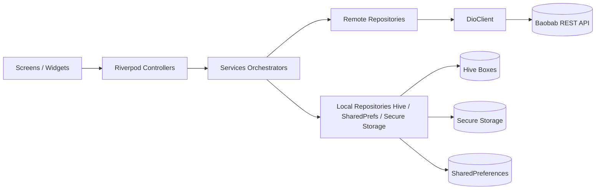
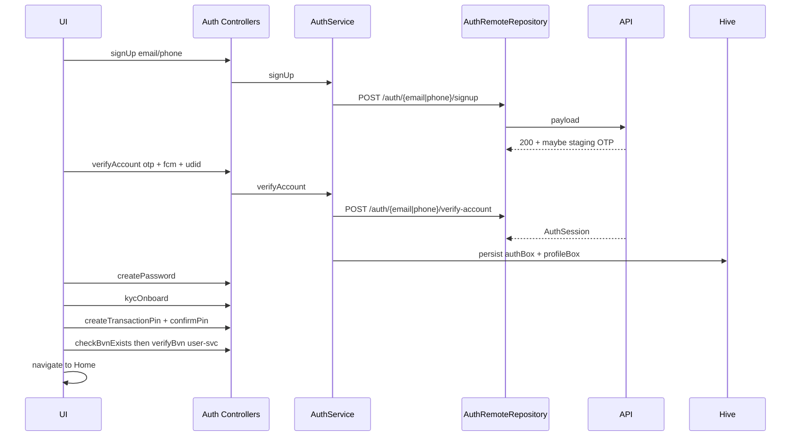
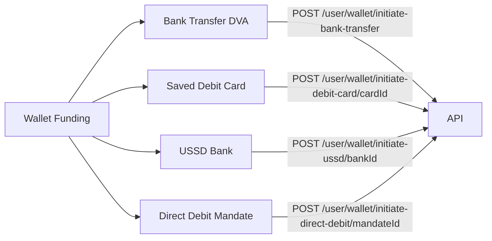
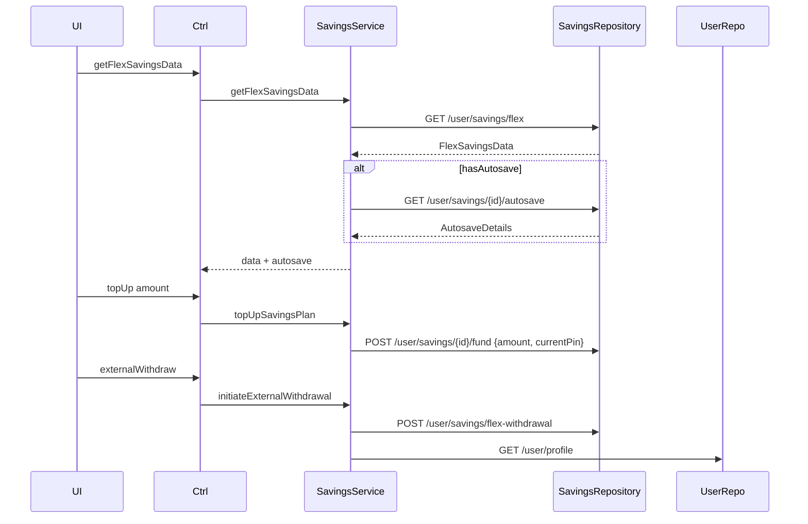

# Baobab — API, Providers, and Code Structure Plan

This document is the authoritative blueprint for (re)generating the Baobab Flutter app's network layer, data models, repositories, services, and Riverpod providers. It distills the existing implementation into a clear contract that a code generator (or developer) can follow to produce a consistent, modular codebase.

> **Companion plans** (per-module deep dives + cross-cutting refactors):
>
> | Plan | Scope |
> |------|-------|
> | [`modules/authentication.md`](modules/authentication.md) | Sign-up / login / reset / KYC / PIN / BVN / referral |
> | [`modules/account.md`](modules/account.md) | Profile / security / referrals / homepage / FCM |
> | [`modules/home.md`](modules/home.md) | Dashboard + wallet-funding entry points |
> | [`modules/bank_and_card.md`](modules/bank_and_card.md) | Banks / cards / wallet funding (non-DD) |
> | [`modules/direct_debit.md`](modules/direct_debit.md) | Direct-debit mandate management |
> | [`modules/savings.md`](modules/savings.md) | Flex / Babybox / Target / Fixed savings + analytics |
> | [`modules/transaction_reports.md`](modules/transaction_reports.md) | Analytics & transactions UI (consumes Savings controllers) |
> | [`refresh_token_interceptor_and_async_value_migration.md`](refresh_token_interceptor_and_async_value_migration.md) | Dio refresh-token interceptor + `NotifierState → AsyncValue` migration |
> | [`mvp_login_home_app.md`](mvp_login_home_app.md) | Stand-alone MVP: new Flutter app with email-only login + minimal homepage |
> | [`mvp_code_generation_steps.md`](mvp_code_generation_steps.md) | Step-by-step execution playbook for generating the MVP project |

The plan is organized as:

1. High-level architecture
2. Cross-cutting infrastructure (Dio client, env, exceptions, NotifierState)
3. Module-by-module catalogue: endpoints, payloads, response models, repositories, services, and Riverpod providers
4. End-to-end flow diagrams (auth, savings, funding, direct debit)
5. Code generation rules / file layout conventions

---

## 1. High-Level Architecture

The app uses a **Clean-Architecture-lite** layered structure per module:

```
lib/app/modules/<module>/
├── data/                 # Repositories (remote + local)
│   ├── <x>_remote_repository.dart
│   └── <x>_local_repository.dart
├── domain/
│   ├── models/           # DTOs, payloads, response objects (with Hive adapters where needed)
│   └── services/         # Business logic orchestrators (compose repositories)
└── presentation/
    ├── controllers/      # Riverpod notifiers / async-notifiers (one per use case)
    ├── components/       # Reusable widgets
    └── screens/          # Pages
```

Cross-cutting concerns live under [`lib/app/core/`](../lib/app/core) and [`lib/app/utils/`](../lib/app/utils):

- [`core/network/dio_client.dart`](../lib/app/core/network/dio_client.dart) — single Dio wrapper used by every repository.
- [`core/network/endpoints.dart`](../lib/app/core/network/endpoints.dart) — all REST URLs as static constants.
- [`core/network/exceptions.dart`](../lib/app/core/network/exceptions.dart) — `NetworkFailure`.
- [`core/network/constants.dart`](../lib/app/core/network/constants.dart) — generic strings (`kSomethingWentWrong`, `kUnableToConnect`).
- [`core/service_setup.dart`](../lib/app/core/service_setup.dart) — `NotifierState<T>`, `ServiceResponse<T>`, `ProcessProvider` helpers used by some modules.



### State management

- **Riverpod** is the only DI / state container.
- Three patterns coexist:
  1. `AutoDisposeAsyncNotifierProvider<T, R>` — for "load-once-cache-with-keepAlive" data (e.g. `savingsProvider`).
  2. `AutoDisposeAsyncNotifierProviderFamily<T, R, A>` — for parameterized fetches (e.g. single-savings details by `savingsId`).
  3. `StateNotifierProvider<Notifier, NotifierState<T>>` — for action-style flows that emit idle/loading/success/error and need imperative `then`/`errorCb` callbacks (Direct Debit, Banks/Cards).

A code generator must decide between (1/2) and (3) using these rules:

- If endpoint is **GET** and result is naturally cached → AsyncNotifier.
- If endpoint is an **action** (POST/PUT/PATCH/DELETE) and the screen needs callbacks (`onSuccess`, `onError`) → StateNotifier with `NotifierState<T>`.

### Local persistence

Hive boxes (typed) — registered at app start in [`main.dart`](../lib/main.dart):

| Box name (HiveConstants)        | Type stored                         | Purpose                                  |
| ------------------------------- | ----------------------------------- | ---------------------------------------- |
| `authBox`                       | `AuthSession?`                      | Current session (token, refresh, flags)  |
| `profileBox`                    | `UserProfile?`                      | Cached user profile                      |
| `securitySettingsBox`           | `SecuritySettings?`                 | Security flags                           |
| `homePageBox`                   | `HomePageData?`                     | Last home payload                        |
| `banksBox`                      | `List<Bank>`                        | Cached banks list                        |
| `bankAccountBox`                | `List<BankAccount>`                 | Saved bank accounts                      |
| `cardsBox`                      | `List<DebitCard>`                   | Saved debit cards                        |
| `adminNotificationsBox`         | `List<AdminNotification>`           | Flash notifications                      |
| `referralDetailsBox`            | `ReferralDetails?`                  | Cached referral details                  |

Secure storage (via [`credentials_repository.dart`](../lib/app/modules/authentication/data/credentials_repository.dart)) holds: `email`, `phoneNumber`, `password`, `transactionPin`.

SharedPreferences flags: `kShowWalletBalance`, `kShowTotalSavings`, `kShowFixedSavings`, `kShowTargetSavings`, `kShowBabyboxSavings`, plus various onboarding tooltip flags.

---

## 2. Cross-Cutting Infrastructure

### 2.1 Environment

[`lib/app/utils/envs.dart`](../lib/app/utils/envs.dart) loads `.env` via `flutter_dotenv`. Required keys: `BASE_URL` (and any third-party keys used in KYC/payments).

### 2.2 DioClient

Single source of truth in [`dio_client.dart`](../lib/app/core/network/dio_client.dart):

- `baseUrl = "${BASE_URL}/api/v1"`
- Default headers `Content-Type: application/json`, `Accept: application/json`.
- Auth header pattern: `Authorization: Bearer <accessToken>` injected per call via `Options(headers: …)` (no global interceptor).
- Two operating modes:
  - **`post/get/put/patch/delete`** — wraps `makeRequest` which:
    - On 401 with "session expired" / "invalid token": clears `authBox`, navigates to `LogInScreen`, throws `NetworkFailure("Session expired", code: -1)`.
    - On 4xx/5xx: throws `NetworkFailure(message, code)`.
    - On socket / timeout: throws `NetworkFailure(kUnableToConnect)`.
  - **`getData<T>/postData<T>/deleteData<T>`** — returns `ServiceResponse<T>` (and via `.toNotifierState()` produces `NotifierState<T>`). Used by Direct Debit, etc.

### 2.3 Exceptions and result wrappers

- `NetworkFailure(String message, {int? code})` — thrown by repositories.
- `ServiceResponse<T> { bool status; int statusCode; String? message; T? data; }`
- `NotifierState<T> { ProviderState state; String? error; T? data; }` with helpers `notifyIdle / notifyLoading / notifySuccess / notifyError`.

### 2.4 Auth token retrieval

Every remote repository receives `accessToken` as an explicit argument. Services obtain it via `AuthLocalRepository.getToken()` (Hive-backed). Refresh flow uses `Endpoints.refreshToken` and `RefreshTokenModel`.

---

## 3. Modules Catalogue

> Notation in tables: `Auth?` Y means the endpoint requires `Authorization: Bearer …`. Unless stated otherwise responses are wrapped as `{ "message": string, "data": <payload> }` and 401 triggers global session-expired handling.

### 3.1 Authentication module

Files:

- Endpoints: [`endpoints.dart`](../lib/app/core/network/endpoints.dart) (auth/* group).
- Remote: [`auth_remote_repository.dart`](../lib/app/modules/authentication/data/auth_remote_repository.dart)
- Local: [`auth_local_repository.dart`](../lib/app/modules/authentication/data/auth_local_repository.dart), [`credentials_repository.dart`](../lib/app/modules/authentication/data/credentials_repository.dart), [`fcm_repository.dart`](../lib/app/modules/authentication/data/fcm_repository.dart)
- Service: [`auth_service.dart`](../lib/app/modules/authentication/domain/services/auth_service.dart)
- Controllers: `lib/app/modules/authentication/presentation/controllers/*`

#### Endpoints

| # | Method | Path (after `/api/v1`)                              | Auth? | Purpose                                  |
|---|--------|------------------------------------------------------|-------|------------------------------------------|
| 1 | POST   | `/auth/email/signup`                                 | N     | Register with email                      |
| 2 | POST   | `/auth/phone-number/signup`                          | N     | Register with phone                      |
| 3 | POST   | `/auth/email/resend-signup-otp`                      | N     | Resend signup OTP (email)                |
| 4 | POST   | `/auth/phone-number/resend-signup-otp`               | N     | Resend signup OTP (phone)                |
| 5 | POST   | `/auth/email/verify-account`                         | N     | Verify signup OTP (email)                |
| 6 | POST   | `/auth/phone-number/verify-account`                  | N     | Verify signup OTP (phone)                |
| 7 | POST   | `/auth/password`                                     | Y     | Create initial password                  |
| 8 | PUT    | `/auth/onboarding-kyc`                               | Y     | Submit onboarding KYC details            |
| 9 | POST   | `/auth/upload-selfie`                                | Y     | Upload selfie for liveness check         |
|10 | PATCH  | `/auth/pin`                                          | Y     | Create transaction PIN                   |
|11 | POST   | `/auth/confirm-pin`                                  | Y     | Confirm transaction PIN                  |
|12 | POST   | `/auth/email/login`                                  | N     | Login with email                         |
|13 | POST   | `/auth/phone-number/login`                           | N     | Login with phone                         |
|14 | POST   | `/auth/email/forgot-password`                        | N     | Initiate forgot-password (email)         |
|15 | POST   | `/auth/phone-number/forgot-password`                 | N     | Initiate forgot-password (phone)         |
|16 | POST   | `/auth/email/verify-reset-token`                     | N     | Verify reset OTP (email)                 |
|17 | POST   | `/auth/phone-number/verify-reset-token`              | N     | Verify reset OTP (phone)                 |
|18 | POST   | `/auth/reset-password`                               | Y(reset token) | Set new password               |
|19 | POST   | `/auth/email/resend-forgot-password-otp`             | N     | Resend forgot-password OTP (email)       |
|20 | POST   | `/auth/phone-number/resend-forgot-password-otp`      | N     | Resend forgot-password OTP (phone)       |
|21 | POST   | `/auth/email/resend-new-device-otp`                  | N     | Resend new-device OTP (email)            |
|22 | POST   | `/auth/phone-number/resend-new-device-otp`           | N     | Resend new-device OTP (phone)            |
|23 | POST   | `/auth/check-bvn-exists`                             | Y     | Check BVN registration                   |
|24 | POST   | `/auth/process-referral`                             | Y     | Apply referral code                      |
|25 | GET    | `/auth/bvn-verification-status?reference=…`          | Y     | Poll BVN verification result             |
|26 | POST   | `/auth/refresh-token`                                | Y     | Refresh access token                     |
|27 | POST   | `/auth/logout`                                       | Y     | Logout                                   |
|28 | POST   | `/auth/initiate-email/verification`                  | Y     | Send OTP to verify email change          |
|29 | POST   | `/auth/initiate-phone/verification`                  | Y     | Send OTP to verify phone change          |
|30 | POST   | `/auth/verify-email`                                 | Y     | Confirm email-change OTP                 |
|31 | POST   | `/auth/verify-phone-number`                          | Y     | Confirm phone-change OTP                 |

#### Request payloads (canonical)

```jsonc
// signup (email/phone variants)
{ "email": "user@x.com" }            // OR { "phone_number": "+234..." }

// verify-account
{ "email|phone_number": "...", "otp": "123456", "fcm_token": "...", "device_token": "..." }

// password (POST /auth/password)
{ "password": "..." }

// onboarding-kyc (PUT)
{
  "first_name": "...", "last_name": "...", "middle_name": "?",
  "date_of_birth": "YYYY-MM-DD", "gender": "male|female",
  "residential_address": "...", "residential_state": "...", "residential_lga": "...",
  "next_of_kin_first_name": "...", "next_of_kin_last_name": "...",
  "next_of_kin_email_address": "...", "next_of_kin_phone_number": "...",
  "referral_code": "?"
}

// pin (PATCH)         { "pin": "1234" }
// confirm-pin (POST)  { "pin": "1234" }

// login
{ "email|phone_number": "...", "password": "...", "device_token": "..." }

// reset-password (Bearer = reset token)
{ "password": "..." }

// check-bvn-exists    { "bvn": "12345678901" }
// process-referral    { "referral_code": "..." }
// refresh-token       { "refresh_token": "..." }
```

#### Response models (in `domain/models/`)

- `AuthSession` (Hive `typeId 0`) — login/verify-account responses, includes `token`, `refreshToken`, `expirationTime`, `tokenExpireAt`, plus all onboarding flags (`isVerifiedBvn`, `isCreatedPin`, `isCompletedOnboardingKyc`, `isSetSecurityQuestion`, `isProcessedOnboardingReferral`, …).
- `RefreshTokenModel` — `{ token, refreshToken, expirationTime, tokenExpireAt }`.
- `SignUpResponse` — `{ otp?, ... }` (otp is echoed back only on staging).
- `VerifyResetPasswordResponse` — `{ resetPasswordToken | resetPinToken, expirationTime }`.
- `BvnCheckResponse`, `BvnVerificationModel` (`bvn_verification_models.dart`).
- `LivenessCheck`, `SelfieUploadResponse`.
- `UserCredentials` (secure storage only).

#### `AuthRemoteRepository` methods (1:1 with endpoints)

`signUp`, `resendSignUpOtp`, `verifyAccount`, `createPassword`, `kycOnboard`, `createTransactionPin`, `confirmTransactionPin`, `logIn`, `refreshAccessToken`, `logout`, `forgotPassword`, `verifyResetPasswordOtp`, `resetPassword`, `resendResetPasswordOtp`, `resendNewDeviceOtp`, `checkBvnExists`, `bvnVerificationStatus`, `processReferral`.

Notable behaviour:

- `logIn` inspects response `message` for `"New device login, verify account with OTP …"` and re-throws `NetworkFailure("new-device", code: -1)` so controllers can route to the new-device verification screen.
- `verifyAccount`/`logIn` toast the OTP (staging only) when present in response.

#### `AuthService` orchestration responsibilities

- After successful `verifyAccount`/`logIn`:
  1. If session userId differs from previous → `clearData()` (wipe all Hive boxes & secure prefs).
  2. `persistAuthSession(session)`.
  3. Save credentials (email/phone + password) in secure storage.
  4. Fetch `UserProfile` and persist to `profileBox`.
- `loginWithBiometrics` reads stored credentials and calls `logIn`.
- `clearData()` is idempotent and used by logout & user switch.

#### Riverpod providers / controllers (presentation)

| File                                                                           | Provider type                              | Calls service method               |
|--------------------------------------------------------------------------------|--------------------------------------------|------------------------------------|
| `sign_up_controller.dart`                                                      | StateNotifier<AsyncValue<void>>            | `signUp`                           |
| `resend_sign_up_otp_controller.dart`                                           | StateNotifier<AsyncValue<void>>            | `resendSignUpOtp`                  |
| `verify_account_controller.dart`                                               | StateNotifier<AsyncValue<AuthSession>>     | `verifyAccount`                    |
| `create_password_controller.dart`                                              | StateNotifier<AsyncValue<void>>            | `createPassword`                   |
| `kyc_onboard_controller.dart`                                                  | StateNotifier<AsyncValue<void>>            | `kycOnboard`                       |
| `create_pin_controller.dart` / `confirm_pin_controller.dart`                   | StateNotifier<AsyncValue<void>>            | `createTransactionPin` / `confirmTransactionPin` |
| `login_controller.dart`                                                        | StateNotifier<AsyncValue<AuthSession>>     | `logIn` / `loginWithBiometrics`    |
| `forgot_password_controller.dart`                                              | StateNotifier<AsyncValue<void>>            | `forgotPassword`                   |
| `verify_reset_password_controller.dart`                                        | StateNotifier<AsyncValue<VerifyResetPasswordResponse>> | `verifyResetPasswordOtp` |
| `reset_password_controller.dart`                                               | StateNotifier<AsyncValue<void>>            | `resetPassword`                    |
| `resend_reset_password_otp_controller.dart` / `resend_new_device_otp_controller.dart` | StateNotifier<AsyncValue<void>>     | `resend*Otp`                       |
| `check_bvn_controller.dart`                                                    | StateNotifier<AsyncValue<BvnCheckResponse>>| `checkBvnExists` + polling status  |
| `update_fcm_controller.dart`                                                   | StateNotifier<AsyncValue<void>>            | `updateFcmToken` (User module)     |

---

### 3.2 User / Account module

Files: [`user_remote_repository.dart`](../lib/app/modules/account/data/user_remote_repository.dart), [`user_local_repository.dart`](../lib/app/modules/account/data/user_local_repository.dart), [`user_service.dart`](../lib/app/modules/account/domain/services/user_service.dart).

#### Endpoints

| Method | Path                                                  | Purpose                              |
|--------|-------------------------------------------------------|--------------------------------------|
| GET    | `/user/profile`                                       | Get profile                          |
| PUT    | `/user/profile`                                       | Update profile                       |
| POST   | `/user/next-of-kin`                                   | Update next of kin                   |
| GET    | `/user/initiate-address-verification`                 | Start Dojah/Smile address check      |
| GET    | `/user/bank-statement?from_date=&to_date=`            | Email bank statement                 |
| GET    | `/user/tier-details`                                  | Tier requirements & status           |
| GET    | `/user/security/forgot-pin`                           | Trigger forgot-pin OTP               |
| POST   | `/user/security/verify-reset-pin-token`               | Verify reset-pin OTP                 |
| PATCH  | `/user/security/reset-pin`                            | Reset PIN (Bearer = reset token)     |
| GET    | `/user/security/resend-reset-pin-otp`                 | Resend reset-pin OTP                 |
| PATCH  | `/user/security/change-password`                      | Change password                      |
| PATCH  | `/user/security/change-pin`                           | Change PIN                           |
| POST   | `/user/verify-bvn`                                    | Submit / revalidate BVN              |
| POST/GET/PATCH | `/user/security/security-question`            | Set / reveal / change security question |
| PATCH  | `/user/security/security-question-choice`             | Enable/disable for payments          |
| PATCH  | `/user/delete-account`                                | Delete account (with PIN)            |
| PATCH  | `/user/deactivate-account`                            | Deactivate account                   |
| POST   | `/user/verify-nin`                                    | Verify NIN                           |
| PATCH  | `/user/fcm-token`                                     | Update FCM token                     |
| GET    | `/user/homepage`                                      | Aggregated dashboard data            |
| GET    | `/user/flash-notifications`                           | Admin/marketing flash notifications  |
| GET    | `/user/referral-details`                              | Referral code & summary              |
| GET    | `/user/referral-history?from_date=&to_date=`          | Paginated referral entries           |

#### Response models

- `UserProfile` (Hive) — full profile shape with `isVerifiedBvn`, `isCompletedProfileDetails`, `tier`, `imageUrl`, `shouldRevalidateBvn`, etc.
- `UpdateProfilePayload`
- `NextOfKinPayload`, `NextOfKinResponse`
- `AddressVerificationResponse`
- `TierDetailsModel`
- `SecurityQuestion`, `SecuritySettings`
- `ReferralDetails`, `ReferralHistoryResponse`
- `AdminNotification` (Hive)
- `HomePageData` (Hive) — wallet balance, savings rollups, banners, DVA accounts, etc. (used by Home module).

#### `UserService` responsibilities

- Wraps every remote method, automatically pulling `accessToken` from `AuthLocalRepository`.
- After mutating remote calls (verify BVN, update profile, set security Q, etc.), refetches `/user/profile` and refreshes `profileBox`.
- For `forgotPin`/`resetPin`: writes the new pin to secure storage credentials.
- For `homepage`: persists into `homePageBox`.

#### Controllers

One Riverpod StateNotifier (or AutoDisposeAsyncNotifier) per use case. Examples:

- `user_profile_controller.dart` — AsyncNotifier returning cached `UserProfile`, refreshable.
- `update_profile_controller.dart` — StateNotifier<AsyncValue<UserProfile>>; called from edit screens.
- `verify_bvn_controller.dart`, `verify_nin_controller.dart`, `forgot_pin_controller.dart`, `reset_pin_controller.dart`, `verify_reset_pin_controller.dart`, `resend_forgot_pin_otp_controller.dart`, `change_password_controller.dart`, `change_pin_controller.dart`, `set_security_question_controller.dart`, `change_security_question_controller.dart`, `reveal_security_question_controller.dart`, `enable_security_question_controller.dart`, `delete_account_controller.dart`, `deactivate_account_controller.dart`, `phone_verification_controller.dart`, `email_verification_controller.dart`, `verify_phone_number_controller.dart`, `verify_email_controller.dart`, `tier_details_controller.dart`, `referral_details_controller.dart`, `referral_history_controller.dart`.

---

### 3.3 Home module

Files: `lib/app/modules/home/...`

#### Endpoints used (already part of User & Wallet groups)

- GET `/user/homepage` → `HomePageData`
- GET `/user/flash-notifications` → `List<AdminNotification>`
- POST `/user/wallet/initiate-bank-transfer` → `BankTransferDetails`

#### Models

- `HomePageData`, `HomeBanner`, `BankTransferDetails`, `DvaAccountModel`.

#### Providers

| Provider | Type | Use case |
|----------|------|----------|
| `homePageController` | AutoDisposeAsyncNotifierProvider<HomePageData> | Loads + caches homepage |
| `adminNotificationsController` | AutoDisposeAsyncNotifierProvider<List<AdminNotification>> | Flash notifications |
| `initiateFundWithBankTransferController` | StateNotifier<AsyncValue<BankTransferDetails>> | Generates DVA / virtual account |

---

### 3.4 Bank & Card module (Wallet funding & accounts)

Files: [`remote_cards_banks_repository.dart`](../lib/app/modules/bank_and_card/data/remote_cards_banks_repository.dart), `local_cards_banks_repository.dart`, `cards_banks_service.dart`, controllers under `presentation/controllers/`.

#### Endpoints

| Method | Path                                            | Purpose                                       |
|--------|-------------------------------------------------|-----------------------------------------------|
| GET    | `/user/accounts/initiate-add-card`              | Get Paystack add-card auth URL                |
| GET    | `/user/accounts/list-banks`                     | Banks list                                    |
| GET    | `/user/accounts/resolve-account-number?...`     | Resolve account holder name                   |
| POST   | `/user/accounts/account-details`                | Add bank account                              |
| POST   | `/user/accounts/initialize-add-bank-account`    | Initialize add-bank flow (deposit verification) |
| GET    | `/user/accounts/bank-accounts`                  | List user's bank accounts                     |
| GET    | `/user/accounts/debit-cards`                    | List user's debit cards                       |
| DELETE | `/user/accounts/{id}/bank-account`              | Delete bank account                           |
| DELETE | `/user/accounts/{id}/debit-card`                | Delete debit card                             |
| POST   | `/user/wallet/initiate-bank-transfer`           | Bank transfer wallet funding                  |
| GET    | `/user/wallet/ussd-banks`                       | USSD-enabled banks                            |
| POST   | `/user/wallet/initiate-ussd/{bankId}`           | USSD wallet funding                           |
| POST   | `/user/wallet/initiate-debit-card/{cardId}`     | Debit card wallet funding                     |
| POST   | `/user/wallet/initiate-direct-debit/{mandateId}`| Direct-debit wallet funding                   |

#### Models

- `Bank`, `BankAccount`, `BankAccountInfo`, `DebitCard`
- `PaystackAuthUrlResponse`, `InitializeAddBankAccount`
- `UssdBank`, `UssdFundingResponse`
- `DebitCardFundingResponse`, `BankTransferDetails`

#### Providers (StateNotifier<AsyncValue<…>> unless noted)

`banksController`, `bankAccountsController`, `cardsController`, `addBankAccountProvider`, `deleteBankAccountController`, `deleteCardController`, `initiateAddCardController`, `initiateFundWithCardController`, `initiateFundWithUssdController`, `initiateFundWithDirectDebitController`, `ussdBanksController`, `resolveAccountNumberController`.

---

### 3.5 Direct Debit module

Files: [`direct_debit_repository.dart`](../lib/app/modules/direct_debit/repository/direct_debit_repository.dart), `controllers/providers/direct_debit_banks_provider.dart`, models in `controllers/models/`.

> This module uses the `dio.getData/postData/deleteData` + `NotifierState<T>` style.

#### Endpoints

| Method | Path                                              | Purpose                                  |
|--------|---------------------------------------------------|------------------------------------------|
| GET    | `/user/accounts/direct-debit-banks`               | Banks supporting direct debit            |
| GET    | `/user/accounts/direct-debit-mandates`            | User's mandates                          |
| POST   | `/user/accounts/initiate-direct-debit`            | Initiate mandate setup                   |
| DELETE | `/user/accounts/{id}/direct-debit-mandate`        | Cancel mandate                           |

#### Models

- `DirectDebitBankModel`
- `DirectDebitMandateModel`
- `InitiateDirectDebitMandateRequest`, `InitiateDirectDebitMandate`

#### Providers (`StateNotifierProvider<T, NotifierState<R>>`)

- `directDebitBankProvider`
- `directDebitMandatesProvider`
- `deleteDirectDebitMandateProvider`
- `initiateDirectDebitMandateProvider`

---

### 3.6 Savings module

Files: [`savings_repository.dart`](../lib/app/modules/savings/data/savings_repository.dart), [`savings_service.dart`](../lib/app/modules/savings/domain/services/savings_service.dart), controllers in `presentation/controllers/`.

#### Endpoints

| Method | Path                                                                                | Purpose                                  |
|--------|-------------------------------------------------------------------------------------|------------------------------------------|
| GET    | `/user/savings`                                                                     | Aggregate savings dashboard              |
| GET    | `/user/savings/flex`                                                                | Flex savings data                        |
| GET    | `/user/savings/babybox`                                                             | All babyboxes                            |
| POST   | `/user/savings/babybox`                                                             | Create babybox                           |
| GET    | `/user/savings/babybox/{savingsId}`                                                 | Babybox details                          |
| GET    | `/user/savings/targets`                                                             | All target plans (note: pluralized)      |
| POST   | `/user/savings/target`                                                              | Create target plan                       |
| GET    | `/user/savings/target/{savingsId}`                                                  | Target plan details                      |
| GET    | `/user/savings/fixed`                                                               | All fixed savings                        |
| POST   | `/user/savings/fixed`                                                               | Create fixed savings                     |
| GET    | `/user/savings/fixed/{savingsId}`                                                   | Fixed savings details                    |
| GET    | `/user/savings/fixed-rates`                                                         | Available fixed interest rates           |
| POST   | `/user/savings/fixed-preview`                                                       | Preview fixed savings (rate & maturity)  |
| POST   | `/user/savings/{savingsId}/fund`                                                    | Top-up plan from wallet                  |
| POST   | `/user/savings/{savingsId}/withdraw`                                                | Withdraw plan to wallet                  |
| POST   | `/user/savings/flex-withdrawal`                                                     | Withdraw flex savings to bank account    |
| POST   | `/user/savings/{savingsId}/autosave`                                                | Set up autosave                          |
| PUT    | `/user/savings/{savingsId}/autosave`                                                | Update autosave                          |
| GET    | `/user/savings/{savingsId}/autosave`                                                | Read autosave config                     |
| GET    | `/user/savings/{savingsId}/interest-details?from_date=&to_date=`                    | Interests earned by plan                 |
| GET    | `/user/analytics/interest?from_date=&to_date=`                                      | Aggregate interest analytics             |
| GET    | `/user/analytics/deposits?from_date=&to_date=`                                      | Aggregate deposits analytics             |
| GET    | `/user/analytics/withdrawals?from_date=&to_date=`                                   | Aggregate withdrawals analytics          |
| GET    | `/user/transactions-history?search=&from_date=&to_date=`                            | Transaction list                         |
| GET    | `/user/transactions-history/{transactionId}` *(actual path used in code)*           | Transaction details                      |

#### Models

Plan-level: `SavingsData`, `FlexSavingsData`, `BabyboxSavingsData`, `BabyboxDetails`, `TargetSavingsData`, `TargetSavingsDetails`, `FixedSavingsData`, `FixedSavingsDetails`.

Payloads: `CreateBabyboxPayload`, `CreateTargetSavingsPayload`, `CreateFixedSavingsPayload`, `FixedSavingsPreviewPayload`, `AutosavePayload`, `AutosaveUpdatePayload`.

Auxiliary: `AutosaveDetails`, `FixedSavingsPreview`, `FixedInterestRate`, `InterestRate`, `AccruedInterest`, `InterestEarnedResponse`, `TransactionHistory`, `BabyboxTransaction`, `FixedSavingsTransaction`, `TargetSavingsTransaction`.

#### Service-level rules

- Top-up, withdraw, external withdrawal, create-fixed, set/update autosave all require `transactionPin` (read from secure storage). If missing → throw `NetworkFailure(kSomethingWentWrong, code: -1)`.
- After external withdrawal, refetch `/user/profile` so `shouldRevalidateBvn` reflects backend state.
- `getFlexSavingsData`, `getSingleBabyboxDetails`, `getSingleTargetSavingsDetails` follow up with `getAutosaveDetails` if `hasAutosave == true`, then return the data via `copyAutosaveDetails(...)`.

#### Providers

`savingsProvider` (AutoDisposeAsyncNotifier<SavingsData>), `flexSavingsProvider`, `babyboxSavingsProvider`, `singleBabyboxController` (Family by `savingsId`), `targetSavingsController`, `singleTargetSavingsController`, `fixedSavingsController`, `singleFixedSavingsController`, `topSavingsController`, `createBabyboxController`, `createTargetSavingsController`, `createFixedSavingsController`, `fixedSavingsPreviewController`, `fixedInterestRatesController`, `autosaveController`, `updateAutosaveController`, `interestsEarnedController`, `interestsAnalyticsController`, `depositsAnalyticsController`, `withdrawalsAnalyticsController`, `transactionsHistoryController`, `transactionDetailsController`, `withdrawToWalletController`, `withdrawalAmountController`, `externalWithdrawalController`.

---

### 3.7 Transaction Reports module

Models: `DepositsAnalyticsResponse`, `InterestsAnalyticsResponse`, `WithdrawalsAnalyticsResponse`, `TransactionDetails`. Controllers reuse the analytics endpoints from the Savings module above.

---

## 4. End-to-End Flows

### 4.1 Sign-up → KYC → PIN → Home



### 4.2 Login (with new-device branch)

```mermaid
flowchart TD
    A[User submits credentials] --> B[AuthService.logIn]
    B --> C[POST /auth/{email|phone}/login]
    C -->|message says "New device login"| D[Throw NetworkFailure 'new-device']
    D --> E[Navigate to NewDeviceVerificationScreen]
    E --> F[verifyAccount with OTP -> normal flow]
    C -->|otherwise| G[Persist session and profile]
    G --> H[Home]
```

### 4.3 Wallet funding options



### 4.4 Savings lifecycle (Flex example)



---

## 5. Code Generation Rules / File Layout Conventions

When generating code from this plan, apply these rules:

1. **One module = one folder** under `lib/app/modules/<module>` with `data/`, `domain/`, `presentation/`.
2. **One endpoint = one method** on the corresponding `*RemoteRepository`. Method name uses `camelCase` of the endpoint's last meaningful segment (e.g., `POST /auth/email/signup` → `signUp(isEmail: true, …)`). Use `isEmail` boolean to merge symmetric email/phone variants.
3. **Auth header injection**: every authenticated method takes `String accessToken` and passes `Options(headers: {"Authorization": "Bearer $accessToken"})` to `DioClient`. No interceptors.
4. **Service layer** reads the access token from `AuthLocalRepository.getToken()` and the transaction pin from `CredentialsRepository.getUserCredentials()`. Repositories never read storage directly.
5. **Models**:
   - Use `factory fromJson(Map<String, dynamic>)` and `Map<String, dynamic> toJson()`.
   - Use `Equatable` for value semantics.
   - Add Hive annotations only for models persisted to disk (`AuthSession`, `UserProfile`, `HomePageData`, `AdminNotification`, `HomeBanner`, `SecuritySettings`, `ReferralDetails`).
   - Snake-case JSON ↔ camelCase Dart fields. Maintain the exact JSON keys already used (the API mixes `currentPin`, `current_pin`, `phone_number`, `bankId`, etc.; preserve them).
6. **Date handling**: query params use `DateFormat("yyyy-MM-dd")`. `DateTime` fields parsed as ISO 8601.
7. **Provider naming**:
   - AsyncNotifier providers end with `…Provider`.
   - Action StateNotifiers end with `…Controller` and live in `presentation/controllers/`.
   - For families, the parameter is the resource id (string).
8. **Error handling**: never `print` raw exceptions; always use `logger.dart` (`logPrint`, `logResponse`). User-facing errors come from `NetworkFailure.message`.
9. **Session expiry**: only the `makeRequest` wrapper handles 401. Service / controller code must not duplicate this.
10. **OTP staging toast**: when a response `data.otp` is non-null (staging only), show via `Fluttertoast`. Already centralised in repository methods that send OTPs.
11. **`NotifierState<T>` vs AsyncValue**: keep the current split — Direct Debit and Banks/Cards prefer `NotifierState`, the rest of the app prefers `AsyncValue`. New "fire-and-forget action" controllers should default to `AsyncValue`.
12. **Generated file layout per module** (template):

    ```
    <module>/
    ├── data/
    │   ├── <module>_remote_repository.dart      // Provider + class
    │   └── <module>_local_repository.dart       // optional
    ├── domain/
    │   ├── models/
    │   │   ├── <model>.dart
    │   │   └── <model>.g.dart                   // Hive only
    │   └── services/
    │       └── <module>_service.dart            // Provider + class
    └── presentation/
        ├── controllers/
        │   └── <use_case>_controller.dart       // 1 file per use case
        ├── components/
        └── screens/
    ```
13. **Endpoints constants**: continue centralising in `lib/app/core/network/endpoints.dart`. Functions allowed for path-param URLs (e.g., `deleteDebitMandate(String id)`).
14. **`pubspec.yaml` dependencies that the generator must keep in sync**: `dio`, `flutter_riverpod`, `hive`, `hive_flutter`, `flutter_secure_storage`, `shared_preferences`, `equatable`, `flutter_dotenv`, `flutter_udid`, `firebase_messaging`, `intl`, `fluttertoast`.

---

## 6. Module ⇄ Endpoint Quick Index

| Module               | Endpoints group(s)                                                                        |
|----------------------|--------------------------------------------------------------------------------------------|
| authentication       | `/auth/*`                                                                                  |
| account (user)       | `/user/profile`, `/user/next-of-kin`, `/user/initiate-address-verification`, `/user/bank-statement`, `/user/tier-details`, `/user/security/*`, `/user/verify-bvn`, `/user/verify-nin`, `/user/delete-account`, `/user/deactivate-account`, `/user/fcm-token`, `/user/referral-details`, `/user/referral-history`, `/auth/initiate-(email|phone)/verification`, `/auth/verify-(email|phone-number)` |
| home                 | `/user/homepage`, `/user/flash-notifications`, `/user/wallet/initiate-bank-transfer`        |
| bank_and_card        | `/user/accounts/*` (excluding direct-debit), `/user/wallet/*` (excluding direct-debit)      |
| direct_debit         | `/user/accounts/direct-debit-*`, `/user/wallet/initiate-direct-debit/{mandateId}`           |
| savings              | `/user/savings/*`                                                                          |
| transaction_reports  | `/user/analytics/*`, `/user/transactions-history*`                                          |

---

## 7. Open items / Considerations for implementation

1. **Pluralization quirk** in `getTargetSavingsData` — the code constructs `"${Endpoints.targetSavings}s"` to hit `/user/savings/targets`. Expose a separate constant `targetSavingsList` to avoid string mutation.
2. **Refresh token interceptor** — currently absent; consider adding a Dio interceptor that proactively calls `/auth/refresh-token` when `expirationTime` is near. Today the app reacts on 401.
3. **Single result wrapper** — long-term, migrate Direct Debit / Bank-Card to `AsyncValue` so the entire app uses one error/loading paradigm.
4. **Pagination** — `referral-history` and `transactions-history` accept date filters but no page params today; revisit when API adds them.
5. **Multipart endpoints** — `/auth/upload-selfie` is a multipart file upload (not shown in detail above). When generating code, handle it via `FormData` and a dedicated method on `AuthRemoteRepository`.
6. **Security question gating** — when `enableSecurityQuestionForPayments == true`, certain mutation endpoints (e.g. external withdrawal) accept an additional `securityAnswer` field. Ensure controllers prompt for it.

---

This plan can be fed to a code generator with the following minimal contract:

> *For each module in section 3, generate the listed endpoints as remote repository methods, the listed payload/response classes as data models (Hive when noted), the service class composing them with auth/PIN access from local repos, and one Riverpod controller per use case in section 3.X. Adhere to the file layout and naming rules in section 5.*
