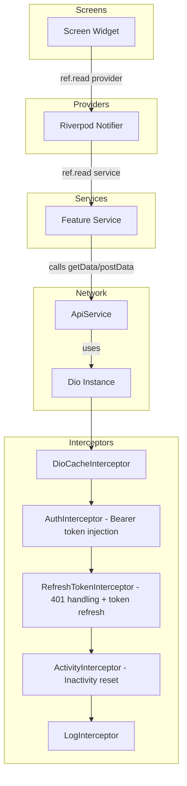
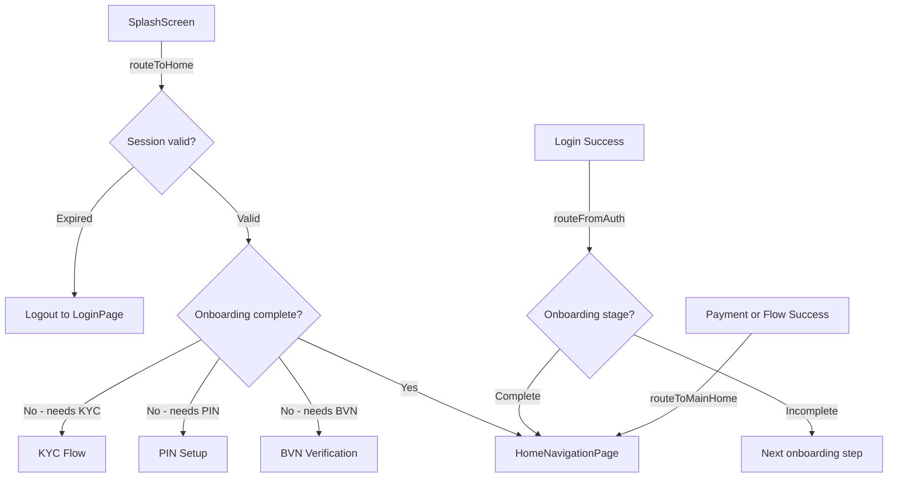
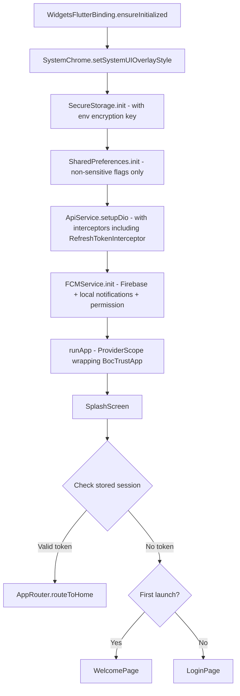
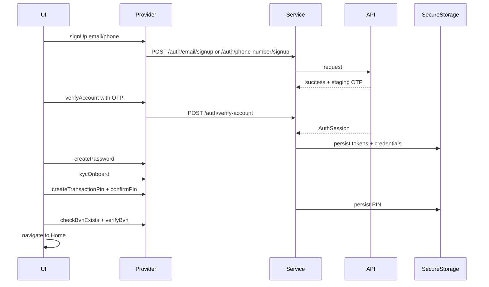
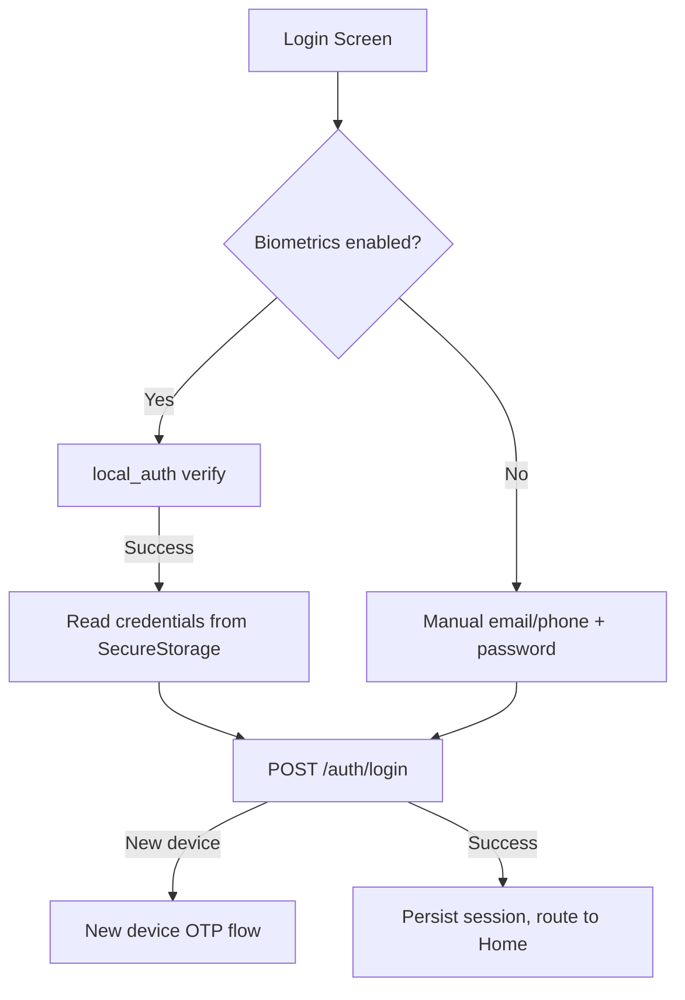
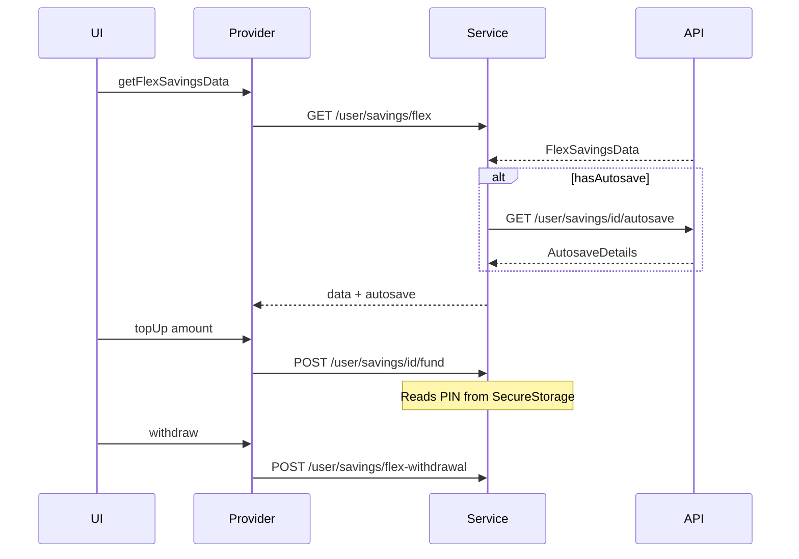
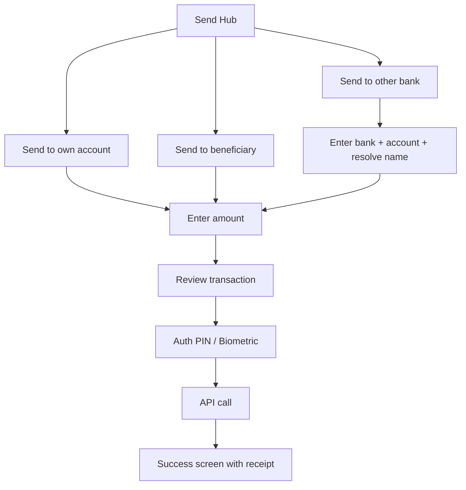

# BOCTrust Savings & Payments App — Architecture & Implementation Plan

> **Purpose:** Authoritative blueprint for building the BOCTrust Flutter mobile application — a savings and payments app for BOCTrust Microfinance Bank. This plan combines KCT's proven project structure with Baobab's API backend, adapted for BOCTrust's product requirements.

---

## Table of Contents

1. [Product Overview](#1-product-overview)
2. [Architecture Decisions](#2-architecture-decisions)
3. [Technology Stack & Dependencies](#3-technology-stack--dependencies)
4. [Directory Structure](#4-directory-structure)
5. [Environment & Build Configuration](#5-environment--build-configuration)
6. [Security Architecture](#6-security-architecture)
7. [Networking Layer](#7-networking-layer)
8. [State Management](#8-state-management)
9. [Routing & Navigation](#9-routing--navigation)
10. [Feature Modules](#10-feature-modules)
11. [Shared Components & Design System](#11-shared-components--design-system)
12. [Utilities & Helpers](#12-utilities--helpers)
13. [App Bootstrap Sequence](#13-app-bootstrap-sequence)
14. [End-to-End Flows](#14-end-to-end-flows)
15. [Implementation Phases](#15-implementation-phases)

---

## 1. Product Overview

BOCTrust is a **Flutter mobile application** for BOCTrust Microfinance Bank, focused on **savings and payments**. It is a single-persona app — every authenticated user has access to the same feature set.

### Core Features (from prototype)

| Feature Area | Capabilities |
|---|---|
| **Onboarding** | Email/phone signup, OTP verification, password creation, KYC onboarding, BVN verification, transaction PIN setup, tier system |
| **Home Dashboard** | Total savings balance with hide/show, daily interest earned, account number, tier status, upgrade prompts, quick actions, recent activity |
| **Savings** | Flex Save (daily interest, withdraw anytime), Target Save (goal-based with auto-save), Lock Save (fixed-term, higher rate), Group Save (collaborative) |
| **Add Money** | Bank transfer (virtual account), debit card funding |
| **Send Money** | Send to own account, send to beneficiary, send to other bank |
| **Payments** | Airtime, data, electricity, water, cable TV, internet, education, scan-to-pay |
| **Account** | Profile, tier management, beneficiary management, linked banks, security settings, support |
| **Security** | Face ID login, fingerprint for transfers, transaction PIN, account freeze |
| **Notifications** | Push notifications with FCM |
| **Future (Coming Soon)** | Loans, virtual/physical cards |

### API Backend

The app communicates with the **same Baobab REST API backend** with identical endpoints documented in [`baobab_api_architecture_plan.md`](baobab_api_architecture_plan.md). All endpoints under `/api/v1/auth/*`, `/user/*`, `/user/savings/*`, `/user/wallet/*`, `/user/accounts/*`, `/user/analytics/*`, and `/user/transactions-history` are reused as-is.

---

## 2. Architecture Decisions

The following table summarizes key architectural choices, drawing from KCT and Baobab patterns:

| Decision | Choice | Rationale |
|---|---|---|
| **Project structure** | KCT-style flat vertical slices: `model/provider/service/screens` per module | Simpler than clean-architecture-lite; proven navigable and maintainable in KCT |
| **State management** | Riverpod 3.x `Notifier` pattern with `NotifierState<T>` | Unified pattern from KCT; avoids the `AsyncValue` vs `NotifierState` split from Baobab |
| **Auth mechanism** | Bearer token with refresh (Baobab API) | Required by the existing API backend |
| **Auth token storage** | FlutterSecureStorage with custom encryption key from env | Enhanced security for a financial app |
| **Session persistence** | FlutterSecureStorage only (no SharedPreferences for credentials) | All sensitive data in encrypted storage; SharedPreferences only for non-sensitive flags |
| **Environment config** | Compile-time `--dart-define-from-file` (KCT style) | Zero-runtime-cost, prevents accidental environment leaks |
| **Navigation** | Global `NavigatorKey` pattern with slide transitions | Enables navigation from non-widget code (interceptors, services); proven in KCT |
| **Network pipeline** | `ApiService -> ServiceResponse<T> -> NotifierState<T>` | Unified KCT pipeline; every API call flows through the same chain |
| **Inactivity detection** | KCT-style `InactivityDetector` with lifecycle handling | Production-grade security for a financial app |
| **Push notifications** | Firebase Cloud Messaging with local notification display | Same three-layer pipeline as KCT: FCMService -> LocalNotificationService -> NotificationNavigator |
| **JSON serialization** | Manual `fromJson`/`toJson` initially; migrate to `freezed` later | Start simple, add code generation when model count grows |

---

## 3. Technology Stack & Dependencies

### Core Framework

| Component | Technology | Version |
|---|---|---|
| Framework | Flutter | SDK ^3.12.2 |
| Language | Dart | 3.x |
| State Management | flutter_riverpod | ^3.x |
| Networking | dio | ^5.x |
| Firebase | firebase_core + firebase_messaging | latest |

### Dependencies by Category

**Networking & Data:**
- `dio` — HTTP client with interceptor support
- `dio_cache_interceptor` — Response caching (memory-based)
- `flutter_secure_storage` — Encrypted storage for tokens and credentials (with custom encryption key)
- `shared_preferences` — Non-sensitive flags only (first-launch, UI toggles like balance visibility)

**Authentication & Security:**
- `local_auth` — Biometric authentication (Face ID, fingerprint)
- `flutter_secure_storage` — Token storage with env-injected encryption key
- `crypto` — Additional cryptographic utilities if needed

**UI & UX:**
- `flutter_svg` — SVG asset rendering
- `cached_network_image` — Image caching
- `shimmer` — Loading skeleton placeholders
- `flutter_spinkit` — Loading spinners
- `pin_code_fields` — OTP and PIN input fields
- `qr_code_scanner` — Scan-to-pay functionality
- `country_code_picker` — Phone number country code selection

**Notifications:**
- `firebase_messaging` — FCM push notifications
- `flutter_local_notifications` — Local notification display

**Payments & Bills:**
- `webview_flutter` — Embedded web content for payment flows (Paystack, etc.)

**Utilities:**
- `intl` — Date/number/currency formatting (Naira)
- `logger` — Structured logging
- `url_launcher` — External URL handling
- `image_picker` — Camera/gallery for selfie upload
- `device_info_plus` — Device information
- `path_provider` — File system paths
- `equatable` — Value equality for models

**Development & Deployment:**
- `flutter_launcher_icons` — App icon generation
- `flutter_native_splash` — Native splash screen
- `mocktail` — Mocking for tests

---

## 4. Directory Structure

```
lib/
├── main.dart                           # Entry point, bootstrap
├── app.dart                            # Root widget with ProviderScope
├── firebase_options.dart               # Generated Firebase config
├── app/                                # Core infrastructure layer
│   ├── app_router.dart                 # Centralized routing service
│   ├── inactivity_detector.dart        # Session timeout widget + logic
│   ├── interceptors.dart               # Dio interceptors (auth, refresh, activity)
│   ├── navigators.dart                 # Navigation helper functions
│   ├── network.dart                    # Dio setup, ApiService class
│   ├── response_handler.dart           # Login processing, logout, dialogs
│   ├── services.dart                   # ServiceResponse, NotifierState, Env config
│   └── theme.dart                      # Colors, ThemeData, global keys, typography
├── helper/                             # Cross-cutting helper services
│   ├── fcm_service.dart                # Firebase Cloud Messaging setup
│   ├── local_notification_service.dart # Local notification display
│   ├── notification_navigator.dart     # Deep link routing from notifications
│   └── secure_storage.dart             # FlutterSecureStorage wrapper with env key
├── module/                             # Feature modules
│   ├── onboarding/                     # Auth: signup, login, password, OTP, KYC
│   │   ├── model/
│   │   ├── provider/
│   │   ├── service/
│   │   └── screens/
│   │       └── components/
│   ├── home/                           # Dashboard, balance, quick actions, activity
│   │   ├── model/
│   │   ├── provider/
│   │   ├── service/
│   │   └── screens/
│   │       └── components/
│   ├── savings/                        # Flex, Target, Lock, Group savings
│   │   ├── model/
│   │   ├── provider/
│   │   ├── service/
│   │   └── screens/
│   │       └── components/
│   ├── send/                           # Send money flows
│   │   ├── model/
│   │   ├── provider/
│   │   ├── service/
│   │   └── screens/
│   │       └── components/
│   ├── payments/                       # Bills, airtime, data, scan-to-pay
│   │   ├── model/
│   │   ├── provider/
│   │   ├── service/
│   │   └── screens/
│   │       └── components/
│   ├── account/                        # Profile, security, support, settings
│   │   ├── model/
│   │   ├── provider/
│   │   ├── service/
│   │   └── screens/
│   │       └── components/
│   ├── wallet/                         # Add money / wallet funding
│   │   ├── model/
│   │   ├── provider/
│   │   ├── service/
│   │   └── screens/
│   │       └── components/
│   ├── notifications/                  # Notification list and detail
│   │   ├── model/
│   │   ├── provider/
│   │   ├── service/
│   │   └── screens/
│   │       └── components/
│   └── component/                      # Shared UI components across modules
│       ├── text_fields.dart
│       ├── toast_snack_widgets.dart
│       ├── info_dialog.dart
│       ├── success_dialog.dart
│       ├── payment_url_page.dart
│       ├── pin_input.dart
│       ├── balance_card.dart
│       ├── transaction_row.dart
│       ├── savings_card.dart
│       ├── bottom_nav_bar.dart
│       ├── sized_boxes.dart
│       └── keypad.dart
└── utils/                              # Global utilities
    ├── assets_path.dart                # Asset path constants
    ├── enums.dart                      # AccountTier, SavingsType, PaymentCategory, etc.
    ├── extensions.dart                 # Dart extensions
    ├── input_formatters.dart           # Text input formatters (Naira, phone, etc.)
    ├── logger.dart                     # Logging wrappers
    ├── strings.dart                    # String constants
    └── utils.dart                      # General utility functions
```

### Module Internal Structure Pattern

Each feature module follows a consistent 4-layer vertical slice:

```
module/<feature_name>/
├── model/          # Data models (request payloads + response objects)
├── provider/       # Riverpod Notifier providers
├── service/        # API service classes (Dio calls via ApiService)
└── screens/        # UI screens (ConsumerWidget / ConsumerStatefulWidget)
    └── components/ # Screen-specific UI components
```

---

## 5. Environment & Build Configuration

### Compile-time Environment Variables

The `Env` abstract class uses `String.fromEnvironment` for compile-time injection:

```dart
abstract final class Env {
  static const environment = String.fromEnvironment('ENV', defaultValue: 'dev');
  static const baseUrl = String.fromEnvironment('BASE_URL', defaultValue: 'https://dev-api.boctrustmfb.com/api');
  static const secureStorageKey = String.fromEnvironment('SECURE_STORAGE_KEY');
  static const secureStorageIv = String.fromEnvironment('SECURE_STORAGE_IV');
  static const paystackPublicKey = String.fromEnvironment('PAYSTACK_PUBLIC_KEY');
  
  static bool get isDev => environment == 'dev';
  static bool get isStaging => environment == 'staging';
  static bool get isProd => environment == 'prod';
}
```

### API Versioning

```dart
String baseUrl({int version = 1}) => '${Env.baseUrl}/v$version';
```

### Env Files

```
# .env.dev
ENV=dev
BASE_URL=https://dev-api.boctrustmfb.com/api
SECURE_STORAGE_KEY=<32-byte-hex-key-for-dev>
SECURE_STORAGE_IV=<16-byte-hex-iv-for-dev>
PAYSTACK_PUBLIC_KEY=pk_test_xxx

# .env.staging
ENV=staging
BASE_URL=https://staging-api.boctrustmfb.com/api
SECURE_STORAGE_KEY=<32-byte-hex-key-for-staging>
SECURE_STORAGE_IV=<16-byte-hex-iv-for-staging>
PAYSTACK_PUBLIC_KEY=pk_test_xxx

# .env.prod
ENV=prod
BASE_URL=https://api.boctrustmfb.com/api
SECURE_STORAGE_KEY=<32-byte-hex-key-for-prod>
SECURE_STORAGE_IV=<16-byte-hex-iv-for-prod>
PAYSTACK_PUBLIC_KEY=pk_live_xxx
```

### Build Commands

```bash
flutter run --dart-define-from-file=.env.dev
flutter build apk --dart-define-from-file=.env.prod
flutter build ios --dart-define-from-file=.env.prod
```

---

## 6. Security Architecture

### Encrypted Secure Storage

FlutterSecureStorage is configured with a **custom AES encryption key injected via the env file**, not the platform default:

```dart
class SecureStorage {
  static late FlutterSecureStorage _instance;

  static Future<void> init() async {
    final encryptionKey = Env.secureStorageKey;
    final iv = Env.secureStorageIv;

    _instance = FlutterSecureStorage(
      aOptions: AndroidOptions(
        encryptedSharedPreferences: true,
        keyCipherAlgorithm: KeyCipherAlgorithm.RSA_ECB_OAEPwithSHA_256andMGF1Padding,
        storageCipherAlgorithm: StorageCipherAlgorithm.AES_GCM_NoPadding,
      ),
      iOptions: IOSOptions(
        accessibility: KeychainAccessibility.first_unlock,
      ),
    );
  }

  // Token management
  static Future<void> saveAccessToken(String token) async => ...;
  static Future<String?> getAccessToken() async => ...;
  static Future<void> saveRefreshToken(String token) async => ...;
  static Future<String?> getRefreshToken() async => ...;
  
  // Credentials (for biometric re-auth)
  static Future<void> saveCredentials({required String identifier, required String password}) async => ...;
  static Future<Map<String, String>?> getCredentials() async => ...;
  
  // Transaction PIN
  static Future<void> saveTransactionPin(String pin) async => ...;
  static Future<String?> getTransactionPin() async => ...;
  
  // Clear all
  static Future<void> clearAll() async => ...;
}
```

### Data Storage Rules

| Data Type | Storage Location | Rationale |
|---|---|---|
| Access token | FlutterSecureStorage | Sensitive auth credential |
| Refresh token | FlutterSecureStorage | Sensitive auth credential |
| User credentials (biometric re-auth) | FlutterSecureStorage | Email/phone + password for biometric login |
| Transaction PIN | FlutterSecureStorage | Financial security credential |
| User profile cache | FlutterSecureStorage (JSON) | Contains PII |
| First-launch flag | SharedPreferences | Non-sensitive UI state |
| Balance visibility toggle | SharedPreferences | Non-sensitive UI preference |
| Inactivity/deactivation timestamps | SharedPreferences | Non-sensitive session metadata |
| Theme preference | SharedPreferences | Non-sensitive UI preference |

### Inactivity Detection

Adopted from KCT's production-grade `InactivityDetector`:

- **Inactivity timeout:** 5 minutes (300 seconds)
- **Warning dialog at:** 4 minutes 30 seconds
- **Resume grace period:** 30 seconds
- **Activity sources:** pointer events, keyboard, focus changes, API calls, global ValueNotifier
- **Lifecycle handling:** paused/hidden/resumed/detached state persistence
- **WebView disable:** static flag to prevent logout during payment flows

### Biometric Authentication

- **Face ID / Fingerprint for login:** Uses `local_auth` package to verify biometrics, then retrieves stored credentials from SecureStorage to call the login API
- **Biometric approval for transfers:** Verifies biometrics before executing send/payment operations, retrieving the transaction PIN from SecureStorage

### Account Freeze

- Client-side flag stored in SecureStorage + server-side endpoint
- When frozen, all transaction-initiating actions are blocked with a user-facing message

---

## 7. Networking Layer

### Architecture



### Dio Setup

```dart
class ApiService {
  static late Dio dio;
  
  static Future<void> setupDio() async {
    dio = Dio(BaseOptions(
      connectTimeout: Duration(seconds: 30),
      receiveTimeout: Duration(seconds: 30),
      headers: {
        'Content-Type': 'application/json',
        'Accept': 'application/json',
      },
    ));

    dio.interceptors.addAll([
      DioCacheInterceptor(options: CacheOptions(store: MemCacheStore())),
      AuthInterceptor(),           // Injects Bearer token from SecureStorage
      RefreshTokenInterceptor(),   // Handles 401, refreshes token, retries
      ActivityInterceptor(),       // Resets inactivity timer on every request
      LogInterceptor(requestBody: true, responseBody: true),
    ]);
  }
}
```

### Key Difference from Baobab: Refresh Token Interceptor

Unlike Baobab's current implementation (which only reacts on 401), BOCTrust includes a **proactive refresh-token Dio interceptor**:

1. On every request, inject `Authorization: Bearer <accessToken>` from SecureStorage
2. On 401 response with "session expired" / "invalid token":
   - Call `POST /auth/refresh-token` with the stored refresh token
   - On success: update tokens in SecureStorage, retry the original request
   - On failure: clear storage, navigate to login

### Generic Service Methods

| Method | Purpose |
|---|---|
| `getData<T>()` | GET with cache policy |
| `postData<T>()` | POST with JSON body |
| `patchData<T>()` | PATCH with optional JSON body |
| `deleteData<T>()` | DELETE with optional body |
| `postFormData<T>()` | POST with FormData for file uploads (selfie) |

### Response Pipeline

```
ApiService.method() -> ServiceResponse<T> -> .toNotifierState() -> NotifierState<T>
```

---

## 8. State Management

### Riverpod 3.x Notifier Pattern (from KCT)

Universal state wrapper:

```dart
class NotifierState<T> {
  final T? data;
  final NotifierStatus status;  // idle | loading | done | error
  final String? message<T> copyWith({...});
  R when<R>({required R Function() idle, required R Function() loading, ...});
}
```

### Provider Pattern

```dart
// 1. Service Provider
final savingsServiceProvider = Provider(
  (ref) => SavingsService(ref.watch(apiServiceProvider)),
);

// 2. Notifier Provider  
final flexSavingsProvider = 
    NotifierProvider<FlexSavingsNotifier, NotifierState<FlexSavingsData>>(
      () => FlexSavingsNotifier(),
    );

// 3. Notifier Class
class FlexSavingsNotifier extends Notifier<NotifierState<FlexSavingsData>> {
  @override
  NotifierState<FlexSavingsData> build() => notifyIdle();

  Future<void> getFlexSavings({Function? then}) async {
    final service = ref.read(savingsServiceProvider);
    state = notifyLoading(state.data);
    state = await service.getFlexSavingsData();
    ProcessProvider.run<FlexSavingsData>(state, doneCb: then, showSuccess: false);
  }
}
```

### ProcessProvider.run — Side Effect Processor

Centralizes toast/snackbar display and callback execution:
- On **done**: calls `doneCb`, optionally shows success toast
- On **error**: calls `errorCb`, optionally shows error toast, optionally forces logout on auth failure

---

## 9. Routing & Navigation

### Navigation Infrastructure

Global `NavigatorKey` pattern with slide transitions (right-to-left default):

| Function | Purpose |
|---|---|
| `pushTo()` | Push with slide transition |
| `pushReplacementTo()` | Replace current route |
| `pushToAndClearStack()` | Push and remove all previous routes |
| `popContext()` | Pop if possible |

### Centralized Router — AppRouter



### Bottom Navigation

5 tabs: **Home**, **Save**, **Send**, **Pay**, **Account**

The shell uses a `TabController` with `ConsumerStatefulWidget` and loads initial data in `initState` via `addPostFrameCallback`.

---

## 10. Feature Modules

### Module Inventory

| Module | Path | Screens | API Endpoints Used |
|---|---|---|---|
| **onboarding** | `module/onboarding/` | Signup, OTP, Password, Login, KYC, BVN, PIN, Tiers | `/auth/*` |
| **home** | `module/home/` | Dashboard, balance card, quick actions, recent activity | `/user/homepage`, `/user/flash-notifications` |
| **savings** | `module/savings/` | Savings hub, Flex, Target, Lock, Group detail screens | `/user/savings/*` |
| **send** | `module/send/` | Send hub, own account, beneficiary, other bank, success | Account endpoints + transfer endpoints |
| **payments** | `module/payments/` | Payments hub, airtime, data, bill pay, scan-to-pay | Bill payment endpoints |
| **wallet** | `module/wallet/` | Add money, bank transfer, debit card funding | `/user/wallet/*` |
| **account** | `module/account/` | Profile, tier upgrade, beneficiaries, linked banks, security, support | `/user/profile`, `/user/security/*`, `/user/tier-details` |
| **notifications** | `module/notifications/` | Notification list | `/user/flash-notifications` |

### Module-to-Baobab API Mapping

Each BOCTrust module maps to the Baobab API modules documented in [`baobab_api_architecture_plan.md`](baobab_api_architecture_plan.md) Section 3:

| BOCTrust Module | Baobab API Module(s) |
|---|---|
| onboarding | 3.1 Authentication |
| home | 3.3 Home (uses `/user/homepage`) |
| savings | 3.6 Savings |
| send | 3.4 Bank & Card (transfer endpoints) |
| payments | Bill payment endpoints (to be defined) |
| wallet | 3.4 Bank & Card (wallet funding), 3.5 Direct Debit |
| account | 3.2 User/Account |
| notifications | Part of 3.3 Home |

---

## 11. Shared Components & Design System

### Design Tokens (from HTML prototype)

**Color Palette:**

| Token | Hex | Usage |
|---|---|---|
| `--navy` | `#142B45` | Primary/CTA, balance card bg, text |
| `--blue` | `#4F7EB4` | Secondary, Target Save accent |
| `--gold` | `#BF910C` | Accent, Flex Save, interest, active indicators |
| `--purple` | `#6E5A96` | Lock Save accent |
| `--green` | `#2F8F5B` | Group Save, positive amounts |
| `--red` | `#C1443A` | Error, negative amounts |
| `--paper` | `#F6F4EE` | Background |
| `--card` | `#FFFFFF` | Card/surface |
| `--ink` | `#16212B` | Primary text |
| `--ink-soft` | `#5B6773` | Secondary text |
| `--line` | `#E7E2D6` | Borders |

**Dark Mode Support:** Yes (prototype includes `.phone.dark` CSS variables)

**Typography:** Plus Jakarta Sans (9 weights: 400-800)

### Shared Component Library

| Component | File | Purpose |
|---|---|---|
| Balance card | `balance_card.dart` | Gradient card with balance, hide/show, interest earned |
| Bottom nav bar | `bottom_nav_bar.dart` | 5-tab navigation (Home, Save, Send, Pay, Account) |
| Quick action grid | `quick_actions.dart` | Circular icon buttons with labels |
| Savings ring card | `savings_card.dart` | Circular progress + amount display |
| Transaction row | `transaction_row.dart` | In/out icon, name, date, amount (colored) |
| PIN input | `pin_input.dart` | 4-digit PIN entry with biometric option |
| Keypad | `keypad.dart` | Custom numeric keypad for amount entry |
| Amount display | `amount_display.dart` | Large formatted amount with currency |
| Settings tile | `settings_tile.dart` | Icon + title + subtitle + chevron/toggle |
| Upgrade banner | `upgrade_banner.dart` | Tier upgrade prompt |
| Text inputs | `text_fields.dart` | Standard text input, phone input with country picker |
| Toast/Snackbar | `toast_snack_widgets.dart` | Success/error/info toasts |
| Dialogs | `info_dialog.dart`, `success_dialog.dart` | Modal dialogs |
| Payment WebView | `payment_url_page.dart` | WebView for Paystack and external flows |

---

## 12. Utilities & Helpers

### Enums

```dart
enum AccountTier { tier1, tier2, tier3 }
enum SavingsType { flex, target, lock, group }
enum TransactionType { credit, debit }
enum PaymentCategory { airtime, data, electricity, water, cableTv, internet, education }
```

### Currency Formatting

All monetary values formatted as Nigerian Naira using `intl`:
```dart
final nairaFormat = NumberFormat.currency(locale: 'en_NG', symbol: '₦', decimalDigits: 2);
```

### Logging

Structured HTTP response logging with `logger` package, same as KCT pattern.

---

## 13. App Bootstrap Sequence



---

## 14. End-to-End Flows

### 14.1 Sign-up -> KYC -> PIN -> BVN -> Home



### 14.2 Login with Biometrics



### 14.3 Savings Lifecycle (Flex Save)



### 14.4 Send Money Flow



---

## 15. Implementation Phases

### Phase 1: Infrastructure Spine

- [ ] Set up project structure: `app/`, `helper/`, `module/`, `utils/` folders
- [ ] Configure environment system with `Env` class and `.env.*` files
- [ ] Implement `SecureStorage` wrapper with custom encryption key from env
- [ ] Implement `SharedPreferences` wrapper for non-sensitive flags
- [ ] Set up Dio with `ApiService` and all interceptors (auth, refresh, cache, activity, logging)
- [ ] Implement `ServiceResponse<T>` and `NotifierState<T>` pipeline
- [ ] Implement `ProcessProvider.run()` side-effect processor
- [ ] Set up theme system with BOCTrust color palette and Plus Jakarta Sans font
- [ ] Implement navigation infrastructure (navigatorKey, helpers, slide transitions)
- [ ] Implement `InactivityDetector` widget
- [ ] Set up Firebase and FCM notification pipeline
- [ ] Create shared component library (bottom nav, balance card, keypad, PIN input, etc.)

### Phase 2: Onboarding Module

- [ ] Implement signup flow (email/phone with OTP)
- [ ] Implement login flow (email/phone + password)
- [ ] Implement biometric login (Face ID / fingerprint)
- [ ] Implement password creation and reset flows
- [ ] Implement KYC onboarding screen
- [ ] Implement BVN verification flow
- [ ] Implement transaction PIN creation and confirmation
- [ ] Implement new-device OTP verification
- [ ] Implement tier overview and upgrade screens
- [ ] Implement `AppRouter` with routing logic (splash -> login/home)

### Phase 3: Home & Account Modules

- [ ] Implement home dashboard (balance card, quick actions, savings cards, recent activity)
- [ ] Implement 5-tab navigation shell
- [ ] Implement account/profile screen
- [ ] Implement security settings (biometric toggles, PIN change, account freeze)
- [ ] Implement notification list screen
- [ ] Implement support screens (chat, call, email)

### Phase 4: Savings Module

- [ ] Implement savings hub with all four savings types
- [ ] Implement Flex Save detail screen (balance, interest, top-up, withdraw)
- [ ] Implement Target Save (goal creation, progress ring, auto-save setup)
- [ ] Implement Lock Save (fixed-term creation, maturity display)
- [ ] Implement Group Save (collaborative savings, member list)
- [ ] Implement autosave configuration (set/update)
- [ ] Implement savings analytics (interest earned, deposits, withdrawals)

### Phase 5: Wallet & Send Modules

- [ ] Implement add money screen (bank transfer with virtual account, debit card)
- [ ] Implement send hub with three send options
- [ ] Implement send-to-own-account flow
- [ ] Implement send-to-beneficiary flow (saved beneficiaries)
- [ ] Implement send-to-other-bank flow (bank selection, account resolution)
- [ ] Implement transaction authentication (PIN + biometric)
- [ ] Implement success/receipt screen
- [ ] Implement beneficiary management (CRUD)
- [ ] Implement linked bank accounts management

### Phase 6: Payments Module

- [ ] Implement payments hub with category grid
- [ ] Implement airtime purchase flow
- [ ] Implement data purchase flow
- [ ] Implement bill payment flows (electricity, water, cable TV, internet, education)
- [ ] Implement scan-to-pay with QR scanner
- [ ] Implement biller list and selection

### Phase 7: Polish & Production Readiness

- [ ] Implement dark mode support
- [ ] Add loading skeletons (shimmer) to all list screens
- [ ] Implement deep linking from push notifications
- [ ] Implement transaction history with search and date filters
- [ ] Add error boundary and crash reporting
- [ ] Write integration tests for critical flows (auth, savings, send)
- [ ] Configure app icons and splash screen
- [ ] Production env configuration and deployment setup

---

> **Companion references:**
> - [`kct-architecture-reference.md`](kct-architecture-reference.md) — Source of project structure patterns and infrastructure blueprints
> - [`baobab_api_architecture_plan.md`](baobab_api_architecture_plan.md) — Source of API endpoints, models, and service contracts
> - [`agent_assets/source.html`](../agent_assets/source.html) — HTML prototype defining UI/UX, screens, and interaction patterns
