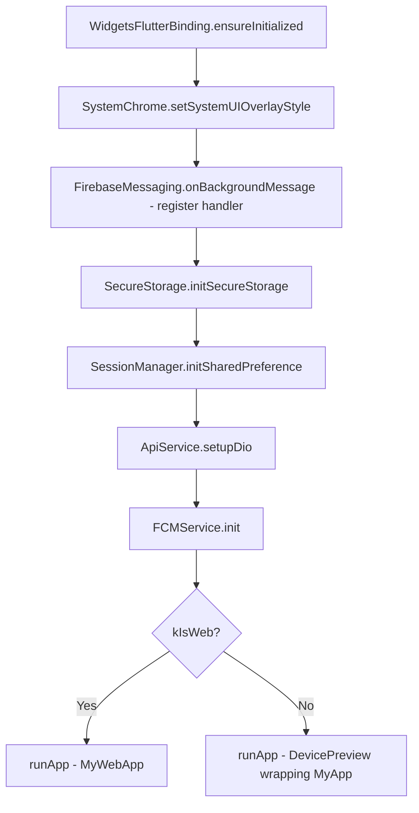
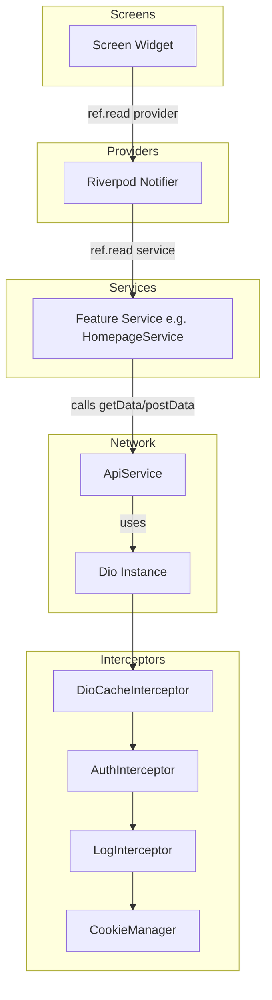
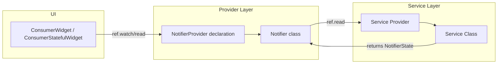
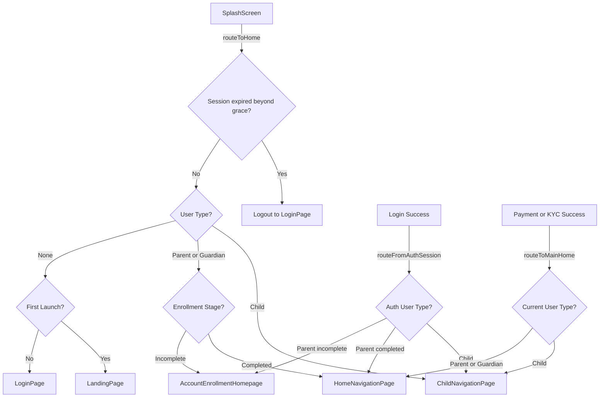
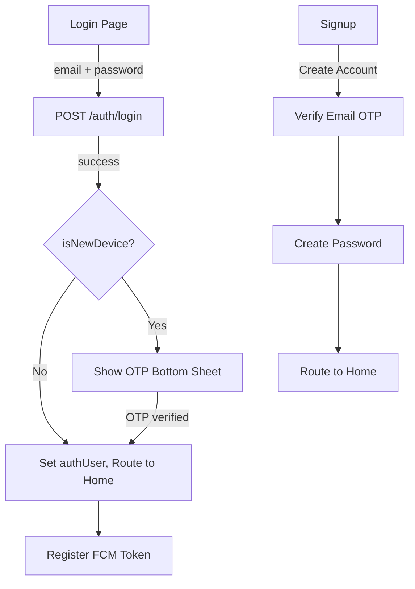
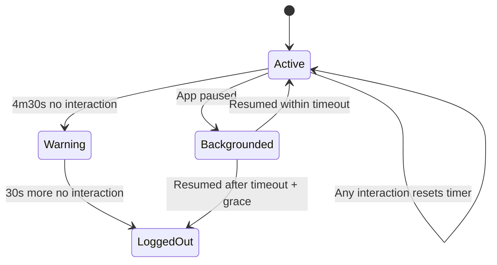
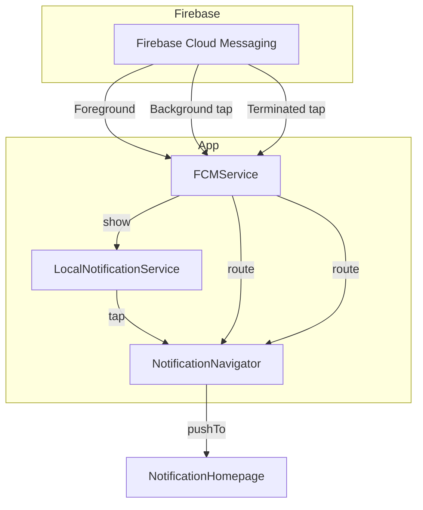
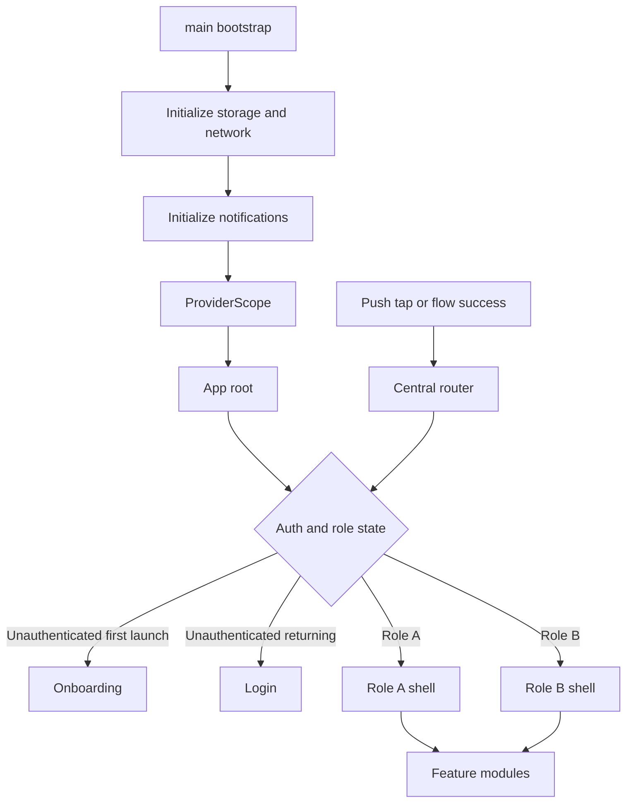

# KCT Project Architecture — Comprehensive Reference Plan

> **Purpose:** This document captures every significant architectural pattern, structural decision, and implementation detail of the KCT Flutter project. It is intended as a transferable reference for replicating the best parts of this architecture in other projects.

---

## Table of Contents

1. [Project Overview](#1-project-overview)
2. [Technology Stack & Dependencies](#2-technology-stack--dependencies)
3. [Directory Structure](#3-directory-structure)
4. [App Bootstrap & Initialization](#4-app-bootstrap--initialization)
5. [Environment & Build Configuration](#5-environment--build-configuration)
6. [Networking Layer](#6-networking-layer)
7. [State Management](#7-state-management)
8. [Routing & Navigation](#8-routing--navigation)
9. [Authentication & Session Management](#9-authentication--session-management)
10. [Security & Inactivity Detection](#10-security--inactivity-detection)
11. [Push Notifications](#11-push-notifications)
12. [Feature Module Architecture](#12-feature-module-architecture)
13. [Shared Components](#13-shared-components)
14. [Theming & Design System](#14-theming--design-system)
15. [Utilities & Helpers](#15-utilities--helpers)
16. [OTA Updates — Shorebird](#16-ota-updates--shorebird)
17. [Strengths to Replicate](#17-strengths-to-replicate)
18. [Reusable Architecture Blueprint for New Projects](#18-reusable-architecture-blueprint-for-new-projects)
19. [Areas for Improvement](#19-areas-for-improvement)

---

## 1. Project Overview

KCT is a **Flutter mobile application** (Android + iOS, with stub web support) for a children's investment trust platform. It supports two distinct user personas:

- **Parent/Guardian** — Enrolls children, manages investments, views dashboards, performs KYC, makes payments
- **Child** — Views their own investment dashboard, fund maturity, bank accounts, settings

The app communicates with a REST API backend, uses Firebase for push notifications, and implements security features like session inactivity timeout and secure storage.

---

## 2. Technology Stack & Dependencies

### Core Framework
| Component | Technology | Version |
|---|---|---|
| Framework | Flutter | SDK ^3.9.2 |
| Language | Dart | 3.x |
| State Management | flutter_riverpod | ^3.0.3 |
| Networking | dio | ^5.5.0+1 |
| Firebase | firebase_core + firebase_messaging | ^4.0.0 / ^16.0.0 |

### Key Dependencies by Category

**Networking & Data:**
- [`dio`](pubspec.yaml) — HTTP client with interceptor support
- [`dio_cache_interceptor`](pubspec.yaml) — Response caching (memory-based, 3-hour max stale)
- [`dio_cookie_manager`](pubspec.yaml) + [`cookie_jar`](pubspec.yaml) — Persistent cookie handling via file storage
- [`shared_preferences`](pubspec.yaml) — Simple key-value session persistence
- [`flutter_secure_storage`](pubspec.yaml) — Encrypted storage for sensitive data

**UI & UX:**
- [`flutter_svg`](pubspec.yaml) — SVG asset rendering
- [`cached_network_image`](pubspec.yaml) — Image caching
- [`shimmer`](pubspec.yaml) — Loading skeleton placeholders
- [`flutter_spinkit`](pubspec.yaml) — Loading spinners
- [`pin_code_fields`](pubspec.yaml) — OTP input fields
- [`flutter_widget_from_html`](pubspec.yaml) — HTML content rendering
- [`gradient_circular_progress_indicator`](pubspec.yaml) — Custom progress indicators
- [`dotted_border`](pubspec.yaml) — Dotted border decorations
- [`photo_view`](pubspec.yaml) — Zoomable image viewer
- [`country_code_picker`](pubspec.yaml) — Phone number country code selection

**Notifications:**
- [`firebase_messaging`](pubspec.yaml) — FCM push notifications
- [`flutter_local_notifications`](pubspec.yaml) — Local notification display

**Utilities:**
- [`intl`](pubspec.yaml) — Date/number formatting
- [`logger`](pubspec.yaml) — Structured logging
- [`url_launcher`](pubspec.yaml) — External URL handling
- [`image_picker`](pubspec.yaml) — Camera/gallery image selection
- [`device_info_plus`](pubspec.yaml) — Device information
- [`age_calculator`](pubspec.yaml) — Age computation from dates
- [`mime`](pubspec.yaml) — MIME type detection
- [`webview_flutter`](pubspec.yaml) — Embedded web content (payment flows)
- [`path_provider`](pubspec.yaml) — File system paths

**Development & Deployment:**
- [`device_preview`](pubspec.yaml) — Multi-device preview (debug only)
- [`shorebird_code_push`](pubspec.yaml) — Over-the-air code push updates
- [`flutter_launcher_icons`](pubspec.yaml) — App icon generation
- [`flutter_native_splash`](pubspec.yaml) — Native splash screen
- [`mocktail`](pubspec.yaml) — Mocking for tests

---

## 3. Directory Structure

```
lib/
├── main.dart                          # Entry point, bootstrap
├── app.dart                           # Root widget (MyApp, MyWebApp)
├── firebase_options.dart              # Generated Firebase config
├── app/                               # Core infrastructure layer
│   ├── app_router.dart                # Centralized routing service
│   ├── inactivity_detector.dart       # Session timeout widget + logic
│   ├── interceptors.dart              # Dio interceptors (auth, activity)
│   ├── navigators.dart                # Navigation helper functions
│   ├── network.dart                   # Dio setup, ApiService class
│   ├── response_handler.dart          # Login processing, logout, dialogs
│   ├── services.dart                  # ServiceResponse, NotifierState, Env config
│   ├── theme.dart                     # Colors, ThemeData, global keys
│   └── user_type_provider.dart        # User type Riverpod providers
├── helper/                            # Cross-cutting helper services
│   ├── fcm_service.dart               # Firebase Cloud Messaging setup
│   ├── local_notification_service.dart # Local notification display
│   ├── notification_navigator.dart    # Deep link routing from notifications
│   ├── secure_storage.dart            # Flutter Secure Storage wrapper
│   └── session_manager.dart           # SharedPreferences session store
├── module/                            # Feature modules
│   ├── onboarding/                    # Auth: login, signup, password, OTP
│   ├── account_enrollment/            # Parent enrollment flow
│   ├── homepage/                      # Parent dashboard & child management
│   ├── child_homepage/                # Child-specific dashboard
│   ├── child_hmo/                     # Child HMO feature
│   ├── kyc_module/                    # KYC verification
│   ├── profile_settings/              # User profile & settings
│   └── component/                     # Shared UI components
└── utils/                             # Global utilities
    ├── assets_path.dart               # Asset path constants
    ├── enums.dart                     # UserType, InvestmentPlan, etc.
    ├── extensions.dart                # Dart extensions
    ├── input_formatters.dart          # Text input formatters
    ├── logger.dart                    # Logging wrappers
    ├── strings.dart                   # String constants
    └── utils.dart                     # General utility functions
```

### Module Internal Structure Pattern

Each feature module follows a consistent internal structure:

```
module/<feature_name>/
├── model/          # Data models (request + response)
├── provider/       # Riverpod StateNotifier/Notifier providers
├── screens/        # UI screens
│   ├── components/ # Screen-specific UI components
│   └── <sub_feature>/
└── service/        # API service classes (Dio calls)
```

---

## 4. App Bootstrap & Initialization

The app bootstrap sequence in [`main()`](lib/main.dart:32) follows a specific order:



**Key details:**
- [`SecureStorage`](lib/helper/secure_storage.dart:8) is initialized synchronously (static late field)
- [`SessionManager`](lib/helper/session_manager.dart:17) awaits SharedPreferences init
- [`ApiService.setupDio()`](lib/app/network.dart:19) configures Dio with cache, cookies, auth interceptor, and logging
- [`FCMService.init()`](lib/helper/fcm_service.dart:14) initializes Firebase, local notifications, requests permission, sets up foreground/background handlers
- Firebase background message handler uses `unawaited()` for [`_checkInitialMessage()`](lib/helper/fcm_service.dart:28) on iOS to avoid APNs deadlock
- [`DevicePreview`](lib/main.dart:44) wraps the app in non-production debug mode

### Root Widget

[`MyApp`](lib/app.dart:7) wraps the entire app in a Riverpod [`ProviderScope`](lib/app.dart:12), uses a global [`navigatorKey`](lib/app/theme.dart:5) for programmatic navigation, and starts with [`SplashScreen`](lib/module/onboarding/screens/onboarding_page.dart:10).

---

## 5. Environment & Build Configuration

### Compile-time Environment Variables

The [`Env`](lib/app/services.dart:14) abstract class uses `String.fromEnvironment` for compile-time injection:

```dart
abstract final class Env {
  static const environment = String.fromEnvironment('ENV', defaultValue: 'dev');
  static const baseUrl = String.fromEnvironment('BASE_URL', defaultValue: '...');
  static const capisWebsite = String.fromEnvironment('CAPIS_WEBSITE', defaultValue: '...');
  static bool get isDev => environment == 'dev';
  static bool get isQa => environment == 'qa';
  static bool get isProd => environment == 'prod';
}
```

Values are injected via `--dart-define-from-file`:
```bash
flutter run --dart-define-from-file=.env.dev
```

The [`.env.example`](.env.example) file documents expected variables:
```
ENV=dev
BASE_URL=https://your-api-base-url.com/api
```

### API Versioning

The [`baseUrl()`](lib/app/services.dart:36) function appends version suffix:
```dart
String baseUrl({int version = 1}) => '${Env.baseUrl}/v$version';
```

---

## 6. Networking Layer

### Architecture Diagram



### Dio Setup — [`ApiService.setupDio()`](lib/app/network.dart:19)

The global `dio` instance is configured with:

1. **Cache:** [`DioCacheInterceptor`](lib/app/network.dart:55) with [`MemCacheStore`](lib/app/network.dart:21), 3-hour max stale, caches on error codes 401/403/500
2. **Auth:** [`AuthInterceptor`](lib/app/interceptors.dart:7) — registers user activity on every request, handles 401 errors globally
3. **Logging:** [`LogInterceptor`](lib/app/network.dart:57) — logs request/response headers and bodies
4. **Cookies:** [`CookieManager`](lib/app/network.dart:63) with [`PersistCookieJar`](lib/app/network.dart:30) — persisted to filesystem

**Base options:**
- 30-second connect & receive timeouts
- Content-Type: application/json
- Custom `platform: kct` header
- Accepts status codes 200-502 (validates in service methods, not Dio)

### Generic Service Methods

[`ApiService`](lib/app/network.dart:18) provides generic typed methods:

| Method | Signature |
|---|---|
| [`getData<T>()`](lib/app/network.dart:66) | GET with cache policy |
| [`postData<T>()`](lib/app/network.dart:156) | POST with JSON body |
| [`patchData<T>()`](lib/app/network.dart:334) | PATCH with optional JSON body |
| [`patchFormData<T>()`](lib/app/network.dart:245) | PATCH with FormData (file uploads) |
| [`deleteData<T>()`](lib/app/network.dart:423) | DELETE with optional body |

Each method:
- Takes an `endpoint` string, `onLog` callback, and `parseResponse` function
- Returns [`ServiceResponse<T>`](lib/app/services.dart:85) — a generic wrapper with `status`, `data`, `message`, `statusCode`
- Handles `DioException` types (connection, timeout, 401) with user-friendly messages
- The `parseResponse` callback receives the raw Dio `Response` and extracts the typed data

### Response Flow

```
ServiceResponse<T>  →  .toNotifierState()  →  NotifierState<T>
```

[`ServiceResponse.toNotifierState()`](lib/app/services.dart:98) converts the network response into the state management layer's [`NotifierState<T>`](lib/app/services.dart:112) which tracks `status` (idle/loading/done/error), `data`, `message`, and `noAuth`.

### Error Handling Strategy

Error handling is uniform across all HTTP methods:
1. **401 Unauthorized** → interceptor shows error snackbar + forces logout via [`ResponseHandler.onLogout()`](lib/app/response_handler.dart:67)
2. **Connection errors** → "No internet connection" message
3. **Timeouts** → "Request timed out" message
4. **Other errors** → Extract message from response body or show generic fallback

---

## 7. State Management

### Provider Architecture — Riverpod 3.x

The state management uses **Riverpod's `Notifier` pattern** (not the older `StateNotifier`):



### State Type — [`NotifierState<T>`](lib/app/services.dart:112)

A universal state wrapper used across all providers:

```dart
class NotifierState<T> {
  final T? data;
  final NotifierStatus status;  // idle | loading | done | error
  final String? message;
  final int statusCode;
  final bool noAuth;
}
```

Key features:
- [`when()`](lib/app/services.dart:143) method for declarative UI rendering based on state
- [`copyWith()`](lib/app/services.dart:127) for immutable state updates
- Helper factories: [`notifyIdle()`](lib/app/services.dart:201), [`notifyLoading()`](lib/app/services.dart:193), [`notifyResponse()`](lib/app/services.dart:177)

### Provider Pattern Example

```dart
// 1. Service Provider (simple Provider)
final homeServiceProvider = Provider(
  (ref) => HomepageService(ref.watch(apiServiceProvider)),
);

// 2. Notifier Provider
final childDetailProvider =
    NotifierProvider<ChildDetailProvider, NotifierState<ChildDetailModel>>(
      () => ChildDetailProvider(),
    );

// 3. Notifier Class
class ChildDetailProvider extends Notifier<NotifierState<ChildDetailModel>> {
  @override
  NotifierState<ChildDetailModel> build() => notifyIdle();

  Future<void> getChildDetail({required String childId, Function? then}) async {
    final repo = ref.read(homeServiceProvider);
    state = notifyLoading(state.data);  // Keep old data while loading
    state = await repo.getChildDetail(childId: childId);
    ProcessProvider.run<ChildDetailModel>(state, doneCb: then, showSuccess: false);
  }
}
```

### [`ProcessProvider.run<T>()`](lib/app/services.dart:217) — Side Effect Processor

A static method that processes provider state changes and executes side effects:
- On **done**: calls `doneCb`, optionally shows success toast
- On **error**: calls `errorCb`, optionally shows error toast, optionally forces logout on auth failure
- Centralizes toast/snackbar display logic

### Pagination Support

[`PaginatedResponse<T>`](lib/app/services.dart:40) wraps paginated API responses:

```dart
class PaginatedResponse<T> {
  final String totalCount, totalPages, page, countPerPage;
  final T data;
  // fromJson with dataGen callback for parsing nested data
}
```

### Global State Variables

Two global variables hold the authenticated user's session:
- [`authUser`](lib/app/services.dart:7): `AuthSession?` — login session data
- [`kctUser`](lib/app/services.dart:8): `KctUserModel?` — full user profile

### User Type Providers

[`user_type_provider.dart`](lib/app/user_type_provider.dart) provides derived Riverpod providers:
- [`userTypeProvider`](lib/app/user_type_provider.dart:8) — current user's `UserType`
- [`isChildProvider`](lib/app/user_type_provider.dart:14), [`isParentProvider`](lib/app/user_type_provider.dart:20), [`isGuardianProvider`](lib/app/user_type_provider.dart:26)
- [`currentUserProvider`](lib/app/user_type_provider.dart:32)
- [`UserTypeExtension`](lib/app/user_type_provider.dart:38) on `WidgetRef` for convenient access

---

## 8. Routing & Navigation

### Navigation Infrastructure

Navigation uses a **global `NavigatorKey`** pattern rather than named routes or a routing package:

[`navigatorKey`](lib/app/theme.dart:5) is a `GlobalKey<NavigatorState>` passed to `MaterialApp.navigatorKey`.

### Navigator Helpers — [`navigators.dart`](lib/app/navigators.dart)

| Function | Purpose |
|---|---|
| [`pushTo()`](lib/app/navigators.dart:30) | Push with slide transition |
| [`pushReplacementTo()`](lib/app/navigators.dart:46) | Replace current route |
| [`pushToAndClearStack()`](lib/app/navigators.dart:94) | Push and remove all previous routes |
| [`pushToAndClearUntil()`](lib/app/navigators.dart:74) | Push and remove until a named route |
| [`popContext()`](lib/app/navigators.dart:24) | Pop if possible |
| [`popUntil()`](lib/app/navigators.dart:62) | Pop until a named route |
| [`canPopPage()`](lib/app/navigators.dart:92) | Check if can pop |

All navigation uses **slide transitions** (right-to-left by default) via [`_createRoute()`](lib/app/navigators.dart:4).

### Centralized Router — [`AppRouter`](lib/app/app_router.dart:19)

A static class encapsulates all user-type, session, enrollment, and post-flow destination decisions. The detailed source-of-truth navigation reference is [`plans/app_navigation_flow.md`](plans/app_navigation_flow.md).



Key methods:
- [`routeToHome()`](lib/app/app_router.dart:22) — Used from `ConsumerWidget` contexts, applies the persisted inactivity expiry check, clears stale deactivation timestamps, and routes by current `UserType`.
- [`routeToMainHome()`](lib/app/app_router.dart:66) — Used from non-widget callbacks and completion flows. It reads global `kctUser`, sends children to [`ChildNavigationPage`](lib/module/child_homepage/screens/navigation_page.dart:21), sends parents/guardians to [`HomeNavigationPage`](lib/module/homepage/screens/parent_homepage/navigation_page.dart:21), and maps `toSettings` to the correct role-specific tab.
- [`routeFromAuthSession()`](lib/app/app_router.dart:88) — Used immediately after login before full user data is hydrated. It clears deactivation time, routes child users to child home, completed parent/guardian users to parent home, and incomplete users to account enrollment.

### Latest Architecture Flow Changes to Carry Forward

| Area | Current Architecture Flow | Reusable Lesson |
|---|---|---|
| Session expiry | [`routeToHome()`](lib/app/app_router.dart:22) reads `SessionManager.getDeactivateTime()`, clears it, and only logs out if the expiry is more than 30 seconds overdue. | Put session-expiry logic behind one top-level router and keep cold-start, resume, and widget-startup behaviour consistent. |
| Role-specific shell routing | [`routeToMainHome()`](lib/app/app_router.dart:66) centralizes post-flow return destinations for both parent/guardian and child users. | Completion flows should ask a router for the right role shell instead of directly choosing screens. |
| Parent shell hydration | [`HomeNavigationPage`](lib/module/homepage/screens/parent_homepage/navigation_page.dart:21) owns the 4-tab parent shell and hydrates profile, notifications, summary, children, and parent transactions after mount. | A role shell should load only the dashboard-level data required by that role. |
| Child shell hydration | [`ChildNavigationPage`](lib/module/child_homepage/screens/navigation_page.dart:21) owns the 2-tab child shell and hydrates dashboard, notifications, KYC, linked accounts, maturity, and HMO data after mount. | Do not force all personas into one tab host when their data and feature surfaces differ. |
| Bottom-nav resilience | [`navButtons()`](lib/module/homepage/screens/components/bottom_nav_bar_buttons.dart:9) and [`childNavButtons()`](lib/module/homepage/screens/components/bottom_nav_bar_buttons.dart:61) use bounded tab content and `FittedBox` labels so active chips fit narrow screens. | Treat tab labels, icon mapping, and shell tab counts as one contract. |
| Payment and KYC exits | Payment and upload flows converge through [`routeToMainHome()`](lib/app/app_router.dart:66) after success instead of duplicating role-specific destination logic. | Long-running feature flows should return typed results or success states, then let the router choose the destination. |
| Notification taps | FCM and local-notification taps dispatch through [`NotificationNavigator`](lib/helper/notification_navigator.dart:4), currently defaulting to the notification list while preserving a future type-based deep-link table. | Isolate push payload parsing from app shell routing, and document payload contracts early. |

### User-Type Aware Widgets

[`UserTypeBuilder`](lib/app/app_router.dart:174) — Renders different widgets based on user type
[`UserTypeConditional`](lib/app/app_router.dart:187) — Simplified conditional rendering (parent vs child)
[`UserTypeAware`](lib/app/app_router.dart:220) — Mixin for `ConsumerState` providing `isChild`, `isParent`, etc.

### Bottom Navigation

- **Parent / Guardian**: 4 tabs — Home, History, Child, Profile via [`HomeNavigationPage`](lib/module/homepage/screens/parent_homepage/navigation_page.dart:21).
- **Child**: 2 tabs — Home, Profile via [`ChildNavigationPage`](lib/module/child_homepage/screens/navigation_page.dart:21).

Each shell uses a `TabController` with `ConsumerStatefulWidget` and loads initial role data in `initState` via `addPostFrameCallback`. Back handling is shell-owned: pressing back from a non-home tab returns to tab 0, while pressing back again from home exits on Android after a short confirmation window.

---

## 9. Authentication & Session Management

### Authentication Flow



### Session Storage — Dual Layer

1. **[`SessionManager`](lib/helper/session_manager.dart:5)** — Uses `SharedPreferences` for:
   - User credentials (email/password for biometric re-auth)
   - Biometrics enabled flag
   - Inactivity/deactivation timestamps
   - First-time launch flag
   - Generic component state persistence

2. **[`SecureStorage`](lib/helper/secure_storage.dart:3)** — Uses `flutter_secure_storage` for:
   - Sensitive tokens (session tokens)
   - User keys
   - Android: default options; iOS: `KeychainAccessibility.first_unlock`

### Cookie-Based Auth

The app uses **cookie-based authentication** (not token headers):
- [`PersistCookieJar`](lib/app/network.dart:30) persists cookies to `$appDocPath/.cookies/`
- `persistSession: false` means session cookies are ephemeral
- On logout, [`cookieJar.deleteAll()`](lib/app/response_handler.dart:69) clears all cookies

### Logout Handling — [`ResponseHandler`](lib/app/response_handler.dart:20)

- [`onLogout()`](lib/app/response_handler.dart:67): Clears session, deletes cookies, pushes to login
- [`showLogoutDialog()`](lib/app/response_handler.dart:73): Platform-adaptive confirmation (Cupertino on iOS, Material on Android)
- [`restartApplication()`](lib/app/response_handler.dart:47): Clears session with delayed navigation

---

## 10. Security & Inactivity Detection

### [`InactivityDetector`](lib/app/inactivity_detector.dart:9) Widget

A `StatefulWidget` with `WidgetsBindingObserver` that wraps the main navigation pages and enforces session timeout:

**Configuration:**
- Inactivity timeout: **5 minutes** (300 seconds)
- Warning shown at: **4 minutes 30 seconds**
- Resume grace period: **30 seconds**

**Activity Detection Sources:**
1. Pointer events (taps, scrolls) via `Listener` widget
2. Hardware keyboard events via `HardwareKeyboard.instance`
3. Focus changes via `FocusManager.instance`
4. API calls via [`AuthInterceptor`](lib/app/interceptors.dart:13) — registers activity on every outgoing request
5. Global `ValueNotifier<DateTime>` ([`lastGlobalInteraction`](lib/app/inactivity_detector.dart:27)) — listened to by the detector for cross-route activity

**Lifecycle Handling:**
- **App paused/hidden**: Persists expiry time via `SessionManager.setDeactivateTime()`
- **App resumed**: Checks if expiry passed; grace period allows brief background visits
- **App detached**: Belt-and-suspenders persist for OEM skins that skip paused state
- **Startup**: Checks persisted expiry to handle cold start after timeout

**WebView Disable:**
- [`isTemporarilyDisabled`](lib/app/inactivity_detector.dart:16) static flag prevents logout during external webview/link interactions
- Automatically re-enabled on resume



---

## 11. Push Notifications

### Architecture



### [`FCMService`](lib/helper/fcm_service.dart:12)

- **[`init()`](lib/helper/fcm_service.dart:14)**: Called once at startup. Initializes Firebase, local notifications, requests permission, sets up handlers
- **[`registerTokenIfLoggedIn()`](lib/helper/fcm_service.dart:32)**: Called after login/signup to register device token with backend via Riverpod provider
- **iOS Deadlock Prevention**: `_checkInitialMessage()` uses `unawaited()` to avoid APNs token registration deadlock

### [`LocalNotificationService`](lib/helper/local_notification_service.dart:23)

- **Idempotent [`init()`](lib/helper/local_notification_service.dart:39)**: Safe to call from both UI and background isolates
- **Android Channel**: `kct_default_channel` with high importance, sound enabled
- **[`show()`](lib/helper/local_notification_service.dart:87)**: Creates system notification from `RemoteMessage`, encodes data as JSON payload for tap handling
- **Tap Handlers**: Both foreground and background taps decode JSON payload and route via `NotificationNavigator`
- **Background Entry Point**: Top-level [`notificationTapBackground()`](lib/helper/local_notification_service.dart:12) with `@pragma('vm:entry-point')` annotation

### [`NotificationNavigator`](lib/helper/notification_navigator.dart:4)

Routes based on notification `type` field in data payload:
- `transaction` → NotificationHomepage (TODO: transaction detail)
- `child_request` → NotificationHomepage (TODO: child request sheet)
- Default → NotificationHomepage

### Background Message Handler

[`_firebaseMessagingBackgroundHandler()`](lib/main.dart:19) in `main.dart`:
- Re-initializes Firebase and local notifications in the background isolate
- For data-only payloads (no `notification` block), manually creates a local notification
- Uses `@pragma('vm:entry-point')` for AOT compatibility

---

## 12. Feature Module Architecture

### Module Inventory

| Module | Path | Description |
|---|---|---|
| **onboarding** | `module/onboarding/` | Login, signup, password creation/reset, OTP verification, landing page |
| **account_enrollment** | `module/account_enrollment/` | Parent enrollment flow: child registration, plan selection, payment |
| **homepage** | `module/homepage/` | Parent dashboard: financial summary, child management, transactions, notifications, KYC |
| **child_homepage** | `module/child_homepage/` | Child dashboard: balance, fund maturity, bank accounts, settings |
| **child_hmo** | `module/child_hmo/` | Child HMO enrollment/management |
| **kyc_module** | `module/kyc_module/` | KYC identity verification, image upload, parent invitation |
| **profile_settings** | `module/profile_settings/` | Profile management, password change, notification preferences, invited parents |
| **component** | `module/component/` | Shared UI components across modules |

### Internal Pattern for Each Module

Each module follows a **4-layer vertical slice** pattern:

```
module/<name>/
├── model/       # Dart classes for API request/response JSON serialization
├── provider/    # Riverpod Notifier + NotifierProvider declarations
├── service/     # API call methods using ApiService
└── screens/     # StatelessWidget/StatefulWidget/ConsumerWidget pages
    └── components/  # Screen-local reusable widgets
```

### Service Layer Pattern

Services are exposed as Riverpod Providers that inject [`ApiService`](lib/app/network.dart:18):

```dart
final homeServiceProvider = Provider(
  (ref) => HomepageService(ref.watch(apiServiceProvider)),
);

class HomepageService {
  final ApiService service;
  HomepageService(this.service);

  Future<NotifierState<T>> someMethod() async {
    return (await service.getData<T>(
      "/endpoint",
      onLog: (res) => logResponse(res),
      parseResponse: (data) => Model.fromJson(data.data["data"]),
    )).toNotifierState();
  }
}
```

### Model Layer Pattern

Models use manual JSON serialization with `fromJson` factory constructors and `toJson()` methods:

```dart
class AuthSession {
  final String email;
  final String userId;
  // ...
  factory AuthSession.fromJson(Map<String, dynamic> json) {
    return AuthSession(email: json["email"] ?? "", ...);
  }
  Map<String, dynamic> toJson() => {"email": email, ...};
}
```

---

## 13. Shared Components

### Location: [`module/component/`](lib/module/component/)

| Component | File | Purpose |
|---|---|---|
| Text inputs | [`text_fields.dart`](lib/module/component/text_fields.dart) | `TextInputWidget`, `PinCodeField`, phone input with country picker |
| Toasts/Snackbars | [`toast_snack_widgets.dart`](lib/module/component/toast_snack_widgets.dart) | `showErrorBar()`, `showSuccessBar()`, `showSnackBar()` using Fluttertoast |
| Dialogs | [`info_dialog.dart`](lib/module/component/info_dialog.dart) | Information dialogs |
| Success | [`success_dialog.dart`](lib/module/component/success_dialog.dart) | Success completion dialogs |
| Payment WebView | [`payment_url_page.dart`](lib/module/component/payment_url_page.dart) | WebView for payment gateway flows |
| Search | [`custom_search_page.dart`](lib/module/component/custom_search_page.dart) | Reusable search UI |
| Price display | [`price_amount_widget.dart`](lib/module/component/price_amount_widget.dart) | Formatted price/amount rendering |
| Spacing | [`sized_boxes.dart`](lib/module/component/sized_boxes.dart) | Pre-defined `SizedBox` constants |

### Toast System

Uses [`Fluttertoast`](lib/module/component/toast_snack_widgets.dart:18) with color-coded toasts:
- Error → Red (`kRed`)
- Success → Green (`kGreen`)
- Info → Orange (`kPrimaryColor`)
- All displayed at `ToastGravity.TOP`

---

## 14. Theming & Design System

### Theme Configuration — [`theme.dart`](lib/app/theme.dart)

**Color Palette:**
- Primary: `#FF6500` (Orange)
- Black variants: `#09090B`, `#323232`, `#4B5061`
- Green: `#189B62` / `#008145`
- Blue variants: `#1E3A8A`, `#1D44B8`, `#0C193F`
- Card backgrounds: blues, greys, orange tints
- Status colors: red (`#DC2626`), green, yellow, orange

**Typography:**
- Custom font: **Geist** (9 weights from Thin to Black)
- Accessed via global `textTheme` using `navigatorKey`

**Global Accessors:**
```dart
final navigatorKey = GlobalKey<NavigatorState>();
final appTheme = Theme.of(navigatorKey.currentState!.context);
final textTheme = Theme.of(navigatorKey.currentState!.context).textTheme;
final screenSize = MediaQuery.of(navigatorKey.currentState!.context).size;
```

**System UI:**
- Light status bar overlay configured at startup

---

## 15. Utilities & Helpers

### Logging — [`logger.dart`](lib/utils/logger.dart)

Wraps the `logger` package:
- [`logResponse()`](lib/utils/logger.dart:9) — Structured HTTP response logging (method, URI, body, status, data)
- [`logPrint()`](lib/utils/logger.dart:18) — General info logging
- [`logSocketException()`](lib/utils/logger.dart:22) — Socket error logging
- [`logTimeoutException()`](lib/utils/logger.dart:29) — Timeout error logging

### Enums — [`enums.dart`](lib/utils/enums.dart)

Rich enums with metadata:
- [`UserType`](lib/utils/enums.dart:1) — parent, guardian, child (with name, prettyName, apiName)
- [`InvestmentPlan`](lib/utils/enums.dart:29) — once, twice, thrice, four_times (with dynamic availability based on cutoff months)
- [`PaymentInterval`](lib/utils/enums.dart:69) — weekly to bi-monthly (with dynamic availability)
- [`ActionType`](lib/utils/enums.dart:118) — resetPassword, signup, login, changePassword

### Asset Paths — [`assets_path.dart`](lib/utils/assets_path.dart)

Centralized constants for all SVG, image, and GIF asset paths.

### Input Formatters — [`input_formatters.dart`](lib/utils/input_formatters.dart)

Custom `TextInputFormatter` implementations for phone numbers, amounts, names, etc.

### General Utilities — [`utils.dart`](lib/utils/utils.dart)

Regex patterns, string formatting, greeting generation, date formatting, image picking, URL launching, and more.

---

## 16. OTA Updates — Shorebird

The project uses **Shorebird Code Push** for over-the-air updates without app store releases:

- Configuration in [`shorebird.yaml`](shorebird.yaml)
- App ID: `d9a309c4-18de-4221-8907-bcf04944eead`
- Auto-update enabled by default (downloads patches on launch)
- Dependency: [`shorebird_code_push`](pubspec.yaml) ^2.0.5

---

## 17. Strengths to Replicate

### 1. Unified Network-to-State Pipeline
The `ApiService → ServiceResponse → NotifierState` chain is elegant. Every API call flows through the same pipeline, and the generic `parseResponse` callback makes it type-safe without code generation. The [`ProcessProvider.run()`](lib/app/services.dart:217) side-effect processor standardizes success/error toast handling.

### 2. Comprehensive Inactivity Detection
The [`InactivityDetector`](lib/app/inactivity_detector.dart:9) is production-grade:
- Detects activity from multiple sources (touch, keyboard, focus, API calls)
- Handles all lifecycle states (paused, hidden, resumed, detached)
- Grace period prevents false positives on brief background visits
- Persists expiry time for cold-start detection
- Temporarily disables during WebView sessions
- Cross-route activity detection via `ValueNotifier`

### 3. Clean Module Architecture
The consistent `model/provider/service/screens` structure per module makes the codebase navigable and maintainable. Each module is a self-contained vertical slice.

### 4. User-Type Conditional Architecture
The [`AppRouter`](lib/app/app_router.dart:19), [`UserTypeBuilder`](lib/app/app_router.dart:174), [`UserTypeConditional`](lib/app/app_router.dart:187), and [`UserTypeAware`](lib/app/app_router.dart:220) mixin provide clean, reusable patterns for multi-persona apps.

### 5. Notification Pipeline
The FCM → LocalNotification → NotificationNavigator pipeline properly handles all three notification states (foreground, background, terminated) with serialized payloads for consistent deep linking.

### 6. Environment Configuration
Compile-time `--dart-define-from-file` approach is zero-runtime-cost and prevents accidental environment leaks.

### 7. Global Navigation without Context
The `navigatorKey` pattern enables navigation from non-widget code (interceptors, services, response handlers) without BuildContext threading.

### 8. Cookie + Interceptor Auth
Cookie-based auth with automatic 401 interception and global logout is robust and avoids manual token management.

---

## 18. Reusable Architecture Blueprint for New Projects

Use KCT as a starting architecture for another Flutter/Riverpod project by copying the **structure and ownership boundaries**, not the domain-specific implementation details. For deeper navigation examples and flow-level route contracts, use [`plans/app_navigation_flow.md`](plans/app_navigation_flow.md) as the companion reference.

### Recommended Target Structure

```text
lib/
├── main.dart
├── app.dart
├── app/
│   ├── app_router.dart
│   ├── navigators.dart
│   ├── network.dart
│   ├── response_handler.dart
│   ├── services.dart
│   ├── theme.dart
│   └── user_type_provider.dart
├── helper/
│   ├── fcm_service.dart
│   ├── local_notification_service.dart
│   ├── notification_navigator.dart
│   └── session_manager.dart
├── module/
│   ├── onboarding/
│   ├── role_a_homepage/
│   ├── role_b_homepage/
│   ├── profile_settings/
│   └── component/
└── utils/
    ├── assets_path.dart
    ├── enums.dart
    ├── extensions.dart
    └── utils.dart
```

### Blueprint Decisions to Make First

| Decision | KCT Pattern | Recommendation for a New Project |
|---|---|---|
| App personas | Parent/guardian and child users are routed to separate shells by [`AppRouter`](lib/app/app_router.dart:19). | Identify user personas early and decide whether each persona needs its own top-level shell, route guard, and bootstrap data set. |
| Top-level routing | KCT uses global navigator helpers plus a centralized static router. | Start with a centralized router contract. For new apps, prefer a typed router package if deep links, web URLs, or route tests are required from day one. |
| Feature boundaries | Features are vertical slices under `module/<feature>/model`, `provider`, `screens`, and `service`. | Keep each feature responsible for its models, API calls, providers, and screens. Share only stable UI and infrastructure through `module/component`, `app`, and `utils`. |
| Network pipeline | `ApiService` returns [`ServiceResponse<T>`](lib/app/services.dart:85), then providers expose [`NotifierState<T>`](lib/app/services.dart:112). | Define one network-to-state pipeline before adding feature services so every API call has the same success, error, loading, and no-auth semantics. |
| Role shell hydration | Parent and child navigation pages fetch only their shell-level data in post-frame callbacks. | Put initial dashboard hydration in the shell that owns the tabs; keep detail screens responsible for detail-only data. |
| Session and logout | [`InactivityDetector`](lib/app/inactivity_detector.dart:9), [`AuthInterceptor`](lib/app/interceptors.dart:7), and [`ResponseHandler`](lib/app/response_handler.dart:67) converge on shared logout behaviour. | Make logout a single app-wide capability used by interceptors, inactivity checks, manual logout, and auth failures. |
| Notifications | [`FCMService`](lib/helper/fcm_service.dart:14), [`LocalNotificationService`](lib/helper/local_notification_service.dart:23), and [`NotificationNavigator`](lib/helper/notification_navigator.dart:4) separate delivery, display, and routing. | Keep push receipt, local display, and deep-link interpretation as separate units with a documented payload contract. |
| Completion exits | Payment, KYC, and profile flows return to home through [`AppRouter.routeToMainHome()`](lib/app/app_router.dart:66). | Long-running flows should return typed results and delegate final destination selection to the router. |

### Project-Structuring Plan for Reuse

1. **Create the infrastructure spine first.** Add `app`, `helper`, `module`, and `utils` folders before feature work begins. Keep bootstrap, theme, routing, network, response handling, session handling, and notifications outside feature modules.
2. **Define route ownership.** Document which router method handles startup, login success, manual logout, post-flow success, notification taps, and role-specific tab selection. Mirror the level of detail in [`plans/app_navigation_flow.md`](plans/app_navigation_flow.md) without copying domain-specific routes.
3. **Model user roles explicitly.** Add a shared role enum, derived role providers, and optional role-aware widgets before building role-specific screens.
4. **Build one feature as the template.** Implement one vertical slice with `model`, `service`, `provider`, and `screens`; then reuse that structure for other modules.
5. **Centralize async state.** Use one generic state wrapper for loading, done, error, and auth failure. Ensure every provider exposes state consistently to screens.
6. **Separate shell data from screen data.** Shells load data needed for tabs and global badges; nested screens load detailed or workflow-specific data.
7. **Document every cross-cutting flow.** Keep separate companion plans for navigation, notifications, environment configuration, and service refactoring so the architecture reference remains concise.
8. **Plan migration seams.** If starting from KCT’s current approach, the main future seams are provider-managed auth state, network response deduplication, and router-package migration. Track those in an implementation plan rather than mixing them into feature work.

### Minimal Architecture Flow for a New App



---

## 19. Areas for Improvement

### 1. Network Code Duplication
The error handling blocks in [`network.dart`](lib/app/network.dart) are duplicated across 5 HTTP methods (~80 lines each). This should be extracted into a private helper:
```dart
ServiceResponse<T> _handleDioError<T>(dynamic e, StackTrace stack) { ... }
```

### 2. Global Mutable State
[`authUser`](lib/app/services.dart:7) and [`kctUser`](lib/app/services.dart:8) are top-level mutable globals. These should be Riverpod providers for better testability and lifecycle management.

### 3. No Code Generation for Models
Manual `fromJson`/`toJson` is error-prone. Consider `json_serializable` or `freezed` for compile-time safety.

### 4. Limited Test Infrastructure
Only `mocktail` is present in dev_dependencies. No test files are visible. The architecture would benefit from integration and unit tests, especially for the network layer and providers.

### 5. No Router Package
The custom `navigatorKey` + push helpers work but lack type safety, deep linking, and web URL support. Consider `go_router` or `auto_route` for declarative routing.

### 6. Notification Deep Linking is Incomplete
[`NotificationNavigator.route()`](lib/helper/notification_navigator.dart:7) has TODO comments and routes everything to `NotificationHomepage`. Deep linking per notification type should be completed.

### 7. No Repository Layer
Services call `ApiService` directly. A repository layer between providers and services would enable caching strategies, offline support, and easier testing via dependency injection.

### 8. Theme Globals Accessed via Navigator Key
```dart
final textTheme = Theme.of(navigatorKey.currentState!.context).textTheme;
```
This can crash if accessed before the navigator is attached. Prefer passing themes via `BuildContext` or using a theme extension.

### 9. Unused Secure Storage
[`SecureStorage`](lib/helper/secure_storage.dart:3) has commented-out methods. The dual storage layer (SharedPreferences + SecureStorage) should have clearer separation of concerns.

### 10. Web Support is Stubbed
[`MyWebApp`](lib/app.dart:24) renders an empty container. If web isn't planned, remove the code to avoid confusion.
